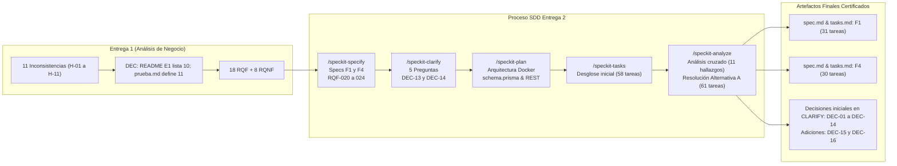

# Entrega 2 — Documentación de Especificación, Clarificación y Trazabilidad de Decisiones

**Proyecto:** Plataforma MIRA — Inteligencia Multimodal para Decisiones Empresariales  
**Empresa:** DPRIME SpA  
**Cliente Piloto:** Aseguradora Nacional (Reembolsos Médicos)  
**Equipo de Ingeniería:** Dante Chávez, Nikolas Lagos (Representante del Cliente), Franko Moraga y Felipe Caru  
**Fecha:** 17 de Octubre de 2026  
**Metodología:** Spec-Driven Development (SDD) con herramientas Agénticas (`speckit-specify`, `speckit-clarify`)

---

## 1. Visión General de la Entrega 2

La **Entrega 2** representa la transición desde la fase de análisis de negocio preliminar (desarrollada en la [Entrega 1](../entrega1/README.md)) hacia la **especificación técnica formal y ejecutable** de las dos funcionalidades medulares del MVP médico de MIRA:

1. **`F1 - Bandeja de revisión asistida`** ([`specs/001-bandeja-revision-asistida/spec.md`](../../specs/001-bandeja-revision-asistida/spec.md)):
   - Visualización integral del expediente en pantalla única sin herramientas externas.
   - Visor documental e imagenológico con ubicación espacial exacta de los hallazgos (`bounding boxes`).
   - Registro inalterable de la decisión del operador liquidador con motivo y marca automática de discrepancias.
   - Lista de trabajo con ordenamiento por prioridad y SLA, monitoreo de tiempo en días y horas hábiles laborables de Chile.
   - Alertas visuales tempranas (<24h hábiles) y escalamiento automático a supervisión (`Vencido_Escalado`).
   - Protocolo de concurrencia híbrida multioperador con arriendo temporal de edición (*lease* de 15 min con *heartbeat*) y resolución atómica.

2. **`F4 - Puntaje y decisión por umbrales`** ([`specs/002-puntaje-decision-umbrales/spec.md`](../../specs/002-puntaje-decision-umbrales/spec.md)):
   - Cálculo cuantitativo normalizado del puntaje de confianza (0–100) con desglose explicable por componentes.
   - Precedencia absoluta de señales de fraude sobre el puntaje total y jerarquía estricta ante causales concurrentes (1º Fraude, 2º Mínimo de señal, 3º Puntaje global).
   - Control estricto de mínimos individuales por señal con piso basal de seguridad por defecto de 60 puntos para señales documentales del MVP.
   - Configuración y auditoría inmutable de umbrales y versiones de flujo por parte del Administrador de Riesgo.
   - Prohibición absoluta de rechazo 100% automático (Principio II de la Constitución / `DEC-04`).
   - Cero cobro comercial de software sobre casos derivados a revisión humana (`DEC-01`).

---

## 2. Índice de Documentos de la Entrega 2

La documentación detallada exigida para esta entrega se organiza en los siguientes artefactos dentro de esta carpeta:

| Documento | Enlace | Propósito y Contenido Principal |
| :--- | :--- | :--- |
| **Informe de Cambios en Especificación (SPECS)** | [`especificacion_cambios.md`](especificacion_cambios.md) | - Matriz comparativa completa de requisitos entre Entrega 1 y Entrega 2 (mantenidos, modificados, fuera de alcance y descartados). - Detalle de los 5 nuevos requisitos funcionales (`RQF-020` a `RQF-024`) con citas directas. - Análisis de alucinaciones y decisiones autónomas del agente (aceptadas y rechazadas con su criterio). - Métricas cuantitativas y cualitativas de autoría agente vs. equipo humano. |
| **Informe de Decisiones y Clarificación (CLARIFY)** | [`clarificacion_cambios.md`](clarificacion_cambios.md) | - Documentación de las 5 preguntas estructuradas formuladas por el agente durante `/speckit-clarify` con sus citas y resoluciones. - Análisis de ambigüedades resueltas por el agente y contraste con el criterio del cliente. - Matriz completa de decisiones de negocio (`DEC-01` a `DEC-14`). - Fichas formales completas de las nuevas decisiones `DEC-13` y `DEC-14` según el estándar de `LLMS.docx`. |
| **Decisiones adicionales de Entrega 2** | [`decisiones_entrega2.md`](decisiones_entrega2.md) | - Registro de la aceptación de DEC-15 sobre sugerencias de aprobación con decisión humana obligatoria. - Registro de DEC-16 sobre la repetición del representante del cliente, su riesgo y mitigación. |
| **Insumos para el informe final** | [`evidencia/insumos_informe.md`](evidencia/insumos_informe.md) | - Estado observado del incremento, trazabilidad y brechas, clasificación de cambios, supuestos invalidados, decisiones, indicadores y comparación de backlogs. No redacta el informe final. |
| **Evolución de Diagramas y Persistencia (PLAN)** | [`cambios_diagramas_persistencia.md`](cambios_diagramas_persistencia.md) | - Evolución del Modelo de Dominio Conceptual (E1) a Modelo Entidad-Relación relacional físico (E2) en PostgreSQL y Prisma. - Tabla de nuevos atributos y entidades exigidos por persistencia (ciclos de vida `estadoCaso`, bounding boxes JSONB, hashes SHA-256, lease de concurrencia y campos PII). - Transformación del Diagrama de Secuencia de `CU-02` hacia interacción multicapa asíncrona (F4 Productor $\to$ F1 Consumidor) en Docker. |
| **Registro de Supuestos Invalidados (PLAN)** | [`supuestos_invalidados.md`](supuestos_invalidados.md) | - Análisis detallado de los 7 supuestos de la Entrega 1 que colapsaron al descender al diseño técnico real. - Registro de quién detectó cada supuesto (Equipo de Ingeniería, Agente de IA o Representante del Cliente). - Solución técnica implementada y lecciones aprendidas de ingeniería. |
| **Análisis Cruzado y Resolución de Brechas (ANALYZE)** | [`analisis_cruzado_especificaciones.md`](analisis_cruzado_especificaciones.md) | - Diagnóstico inicial con métricas de 11 hallazgos (3 críticos en PII, supresión y dependencias DB). - Evaluación de alternativas y adopción de la Alternativa A (refinamiento focalizado). - Tablas de cambios en modelo relacional, tareas de F1/F4 (58 $\to$ 61 tareas) y endpoints OpenAPI. - Certificación final post-refinamiento con 100% de cobertura y 0 incidentes críticos. |

---

## 3. Resumen Ejecutivo de Trazabilidad entre Entregas

### Síntesis de Requisitos Funcionales y No Funcionales
- **Requisitos funcionales de Entrega 1 presentes en las tablas de F1/F4:** 10 IDs únicos: nueve eran Must en E1 (`RQF-002`, `RQF-004`, `RQF-005`, `RQF-006`, `RQF-007`, `RQF-008`, `RQF-009`, `RQF-010` y `RQF-011`) y `RQF-015` era Should en E1, aunque F4 lo clasifica Must. `RQF-013` se menciona como precondición SSO, pero no aparece como fila de requisito en las matrices de estas dos specs.
- **Requisitos no funcionales referenciados por F1/F4:** los 8 IDs `RQNF-001` a `RQNF-008`; las matrices marcan 6 como Must (`001`–`006`) y 2 como Should (`007` y `008`). La presencia en las matrices no significa que todos cuenten con prueba automatizada de aceptación.
- **Requisitos de Entrega 1 diferidos a especificaciones específicas:** `RQF-001`, `RQF-003`, `RQF-012` (Ingesta / Conectores), `RQF-014` (UI de supresión de titular, con backend preparado), `RQF-016` (Exportación de datos), `RQF-017` (Webhooks).
- **Requisito descartado:** `RQF-018` (Migración de pilotos pasados, ratificado como *Won't*).
- **Requisitos nuevos creados en Entrega 2:** `RQF-020` (Ubicación visual de hallazgos), `RQF-021` (SLA hábil y escalamiento), `RQF-022` (Mínimos por señal y piso basal 60 pts), `RQF-023` (Precedencia estricta de fraude y jerarquía), `RQF-024` (Lista de trabajo y concurrencia híbrida multiusuario).

**Nota sobre los conteos:** `docs/entrega1/prueba.md` contiene 18 IDs RQF (`RQF-001`–`RQF-018`), 8 RQNF y definiciones `DEC-01`–`DEC-11`; en cambio, `docs/entrega1/README.md` enumera solo `DEC-01`–`DEC-10`. No se editó Entrega 1. Las dos tablas de requisitos de F1/F4 contienen 15 IDs RQF únicos (los 10 anteriores y los 5 nuevos `RQF-020`–`RQF-024`) y 8 IDs RQNF únicos. En decisiones, la matriz de `clarificacion_cambios.md` llega a `DEC-14`, mientras que la Constitución lista hasta `DEC-12`; DEC-15 y DEC-16 se registran en [`decisiones_entrega2.md`](decisiones_entrega2.md). La matriz y la Constitución son fuentes distintas y no se afirma aquí que sus rangos sean idénticos.

### Síntesis de Decisiones (DEC)
- **Decisiones intactas:** `DEC-01`, `DEC-02`, `DEC-03`, `DEC-05`, `DEC-06`, `DEC-07`, `DEC-08`, `DEC-09`, `DEC-10`, `DEC-12`.
- **Decisiones modificadas / ampliadas:**
  - `DEC-04` (Control humano y no rechazo automático): Se amplió para impedir cierres desestimatorios al expirar el SLA (transiciona a `Vencido_Escalado`) y para formalizar que ante causales concurrentes Fraude prima en la clasificación.
  - `DEC-11` (Umbrales por flujo): Se amplió para formalizar el piso basal de seguridad por defecto de 60 puntos para señales documentales en el MVP médico.
- **Nuevas decisiones formalizadas:**
  - `DEC-13`: Cómputo del SLA en días y horas hábiles laborables de Chile (Lun-Vie 08:30–18:30 hrs) con escalamiento automático a supervisión.
  - `DEC-14`: Protocolo de concurrencia híbrida y arriendo temporal de edición (*lease* de 15 min renovable por *heartbeat*) con resolución atómica *first-to-submit*.

---

## 4. Estado verificado del incremento y siguientes pasos

La implementación de F1 y F4 ya existe en el repositorio; `/speckit-implement` no es el siguiente paso. El estado documentado aquí se limita a lo inspeccionado y ejecutado durante la verificación:

1. **Código y arquitectura**: existen los módulos NestJS, la interfaz Next.js, PostgreSQL/Prisma y los artefactos SDD de F1 y F4. La existencia de la implementación no implica que todos los criterios de aceptación o NFR estén verificados.
2. **Pruebas ejecutadas**: en la reejecución final pasaron 16 suites/172 pruebas backend, 3 suites/41 pruebas backend `test:e2e` y el typecheck. Playwright pasó 2/6 y falló 4/6 porque la base Compose compartida ya no contenía el caso semilla 002 esperado; no se volvió a cargar el seed para no borrar datos. Una ejecución histórica aislada registró 6/6 en `mira-clean3`. Detalles en la [matriz de pruebas](./evidencia/matriz_pruebas.md).
3. **Verificación funcional de F4**: la evidencia disponible para el seed de este historial registra señales 80/65/78 con pesos 0,40/0,35/0,25, que suman 74,25, mientras el seed persiste 74,0 y la UI compacta muestra 74/100. Esta diferencia de 0,25 no se corrigió en el alcance actual. Los escenarios de scoring por API y el detalle están en [verificacion_F4.md](./evidencia/verificacion_F4.md).
4. **Limitación de RUT**: el seed guarda el valor parcialmente enmascarado y el backend lo vuelve a enmascarar. La verificación existente observó `***` en la respuesta/UI. No se cambió esa lógica; se dejó una propuesta de corrección pendiente de revisión en los insumos para el informe.
5. **Insumos para el informe**: la clasificación de cambios, trazabilidad, supuestos invalidados, decisiones y métricas calculadas con sus límites están en [insumos_informe.md](./evidencia/insumos_informe.md).
6. **Siguientes pasos**: revisar el estado de datos antes de repetir Playwright con semilla limpia; el seed elimina decisiones y auditorías. No se declara cobertura normativa del 100% con la evidencia disponible.
