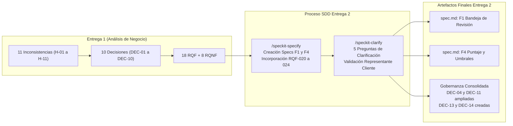

# Entrega 2 — Documentación de Especificación, Clarificación y Trazabilidad de Decisiones

**Proyecto:** Plataforma MIRA — Inteligencia Multimodal para Decisiones Empresariales  
**Empresa:** DPRIME SpA  
**Cliente Piloto:** Aseguradora Nacional (Reembolsos Médicos)  
**Equipo de Ingeniería:** Dante Chávez, Nikolas Lagos (Representante del Cliente), Franko Moraga y Felipe Caru  
**Fecha:** 17 de Octubre de 2026  
**Metodología:** Spec-Driven Development (SDD) con herramientas Agénticas (`speckit-specify`, `speckit-clarify`)

---

## 1. Visión General de la Entrega 2

La **Entrega 2** representa la transición desde la fase de análisis de negocio preliminar (desarrollada en la [Entrega 1](file:///home/franko/Codigos/Entregas_DSLLMs/docs/entrega1/README.md)) hacia la **especificación técnica formal y ejecutable** de las dos funcionalidades medulares del MVP médico de MIRA:

1. **`F1 - Bandeja de revisión asistida`** ([`specs/001-bandeja-revision-asistida/spec.md`](file:///home/franko/Codigos/Entregas_DSLLMs/specs/001-bandeja-revision-asistida/spec.md)):
   - Visualización integral del expediente en pantalla única sin herramientas externas.
   - Visor documental e imagenológico con ubicación espacial exacta de los hallazgos (`bounding boxes`).
   - Registro inalterable de la decisión del operador liquidador con motivo y marca automática de discrepancias.
   - Lista de trabajo con ordenamiento por prioridad y SLA, monitoreo de tiempo en días y horas hábiles laborables de Chile.
   - Alertas visuales tempranas (<24h hábiles) y escalamiento automático a supervisión (`Vencido_Escalado`).
   - Protocolo de concurrencia híbrida multioperador con arriendo temporal de edición (*lease* de 15 min con *heartbeat*) y resolución atómica.

2. **`F4 - Puntaje y decisión por umbrales`** ([`specs/002-puntaje-decision-umbrales/spec.md`](file:///home/franko/Codigos/Entregas_DSLLMs/specs/002-puntaje-decision-umbrales/spec.md)):
   - Cálculo cuantitativo normalizado del puntaje de confianza (0–100) con desglose explicable por componentes.
   - Precedencia absoluta de señales de fraude sobre el puntaje total y jerarquía estricta ante causales concurrentes (1º Fraude, 2º Mínimo de señal, 3º Puntaje global).
   - Control estricto de mínimos individuales por señal con piso basal de seguridad por defecto de 60 puntos para señales documentales del MVP.
   - Configuración y auditoría inmutable de umbrales y versiones de flujo por parte del Administrador de Riesgo.
   - Prohibición absoluta de rechazo 100% automático (Principio II de la Constitución / `DEC-04`).
   - Cero cobro comercial de software sobre casos derivados a revisión humana (`DEC-01`).

---

## 2. Índice de Documentos de la Entrega 2

La documentación detallada exigida para esta entrega se organiza en los siguientes artefactos dentro de esta carpeta:

| Documento | Enlace | Propósito y Contenido Principal |
| :--- | :--- | :--- |
| **Informe de Cambios en Especificación (SPECS)** | [`especificacion_cambios.md`](file:///home/franko/Codigos/Entregas_DSLLMs/docs/entrega2/especificacion_cambios.md) | - Matriz comparativa completa de requisitos entre Entrega 1 y Entrega 2 (mantenidos, modificados, fuera de alcance y descartados). - Detalle de los 5 nuevos requisitos funcionales (`RQF-020` a `RQF-024`) con citas directas. - Análisis de alucinaciones y decisiones autónomas del agente (aceptadas y rechazadas con su criterio). - Métricas cuantitativas y cualitativas de autoría agente vs. equipo humano. |
| **Informe de Decisiones y Clarificación (CLARIFY)** | [`clarificacion_cambios.md`](file:///home/franko/Codigos/Entregas_DSLLMs/docs/entrega2/clarificacion_cambios.md) | - Documentación de las 5 preguntas estructuradas formuladas por el agente durante `/speckit-clarify` con sus citas y resoluciones. - Análisis de ambigüedades resueltas por el agente y contraste con el criterio del cliente. - Matriz completa de decisiones de negocio (`DEC-01` a `DEC-14`). - Fichas formales completas de las nuevas decisiones `DEC-13` y `DEC-14` según el estándar de `LLMS.docx`. |
| **Evolución de Diagramas y Persistencia (PLAN)** | [`cambios_diagramas_persistencia.md`](file:///home/franko/Codigos/Entregas_DSLLMs/docs/entrega2/cambios_diagramas_persistencia.md) | - Evolución del Modelo de Dominio Conceptual (E1) a Modelo Entidad-Relación relacional físico (E2) en PostgreSQL y Prisma. - Tabla de nuevos atributos y entidades exigidos por persistencia (ciclos de vida `estadoCaso`, bounding boxes JSONB, hashes SHA-256, lease de concurrencia). - Transformación del Diagrama de Secuencia de `CU-02` hacia interacción multicapa asíncrona (F4 Productor $\to$ F1 Consumidor) en Docker. |
| **Registro de Supuestos Invalidados (PLAN)** | [`supuestos_invalidados.md`](file:///home/franko/Codigos/Entregas_DSLLMs/docs/entrega2/supuestos_invalidados.md) | - Análisis detallado de los 7 supuestos de la Entrega 1 que colapsaron al descender al diseño técnico real. - Registro de quién detectó cada supuesto (Equipo de Ingeniería, Agente de IA o Representante del Cliente). - Solución técnica implementada y lecciones aprendidas de ingeniería. |

---

## 3. Resumen Ejecutivo de Trazabilidad entre Entregas

### Síntesis de Requisitos Funcionales
- **Requisitos de Entrega 1 integrados en F1 y F4:** `RQF-004`, `RQF-005`, `RQF-006`, `RQF-007`, `RQF-008`, `RQF-009`, `RQF-010`, `RQF-011`, `RQF-013` y `RQF-015`.
- **Requisitos de Entrega 1 diferidos a especificaciones específicas:** `RQF-001`, `RQF-002`, `RQF-003`, `RQF-012` (Ingesta / Conectores), `RQF-014` (Privacidad / Supresión PII), `RQF-016` (Exportación de datos), `RQF-017` (Webhooks).
- **Requisito descartado:** `RQF-018` (Migración de pilotos pasados, ratificado como *Won't*).
- **Requisitos nuevos creados en Entrega 2:** `RQF-020` (Ubicación visual de hallazgos), `RQF-021` (SLA hábil y escalamiento), `RQF-022` (Mínimos por señal y piso basal 60 pts), `RQF-023` (Precedencia estricta de fraude y jerarquía), `RQF-024` (Lista de trabajo y concurrencia híbrida multiusuario).

### Síntesis de Decisiones (DEC)
- **Decisiones intactas:** `DEC-01`, `DEC-02`, `DEC-03`, `DEC-05`, `DEC-06`, `DEC-07`, `DEC-08`, `DEC-09`, `DEC-10`, `DEC-12`.
- **Decisiones modificadas / ampliadas:**
  - `DEC-04` (Control humano y no rechazo automático): Se amplió para impedir cierres desestimatorios al expirar el SLA (transiciona a `Vencido_Escalado`) y para formalizar que ante causales concurrentes Fraude prima en la clasificación.
  - `DEC-11` (Umbrales por flujo): Se amplió para formalizar el piso basal de seguridad por defecto de 60 puntos para señales documentales en el MVP médico.
- **Nuevas decisiones formalizadas:**
  - `DEC-13`: Cómputo del SLA en días y horas hábiles laborables de Chile (Lun-Vie 08:30–18:30 hrs) con escalamiento automático a supervisión.
  - `DEC-14`: Protocolo de concurrencia híbrida y arriendo temporal de edición (*lease* de 15 min renovable por *heartbeat*) con resolución atómica *first-to-submit*.

---

## 4. Estado del Proyecto y Pasos Siguientes

Con la generación de las especificaciones (`/speckit-specify`), la clarificación de requerimientos (`/speckit-clarify`) y el diseño del plan técnico (`/speckit-plan`):
1. Las especificaciones de `F1` y `F4` se encuentran formalmente cerradas y ratificadas por el Representante del Cliente.
2. Ambas especificaciones aprobaron al 100% sus listas de verificación de calidad (`checklists/requirements.md`).
3. El **Plan Técnico de Implementación** ha quedado consolidado en [`specs/001-bandeja-revision-asistida/plan.md`](file:///home/franko/Codigos/Entregas_DSLLMs/specs/001-bandeja-revision-asistida/plan.md) y [`specs/002-puntaje-decision-umbrales/plan.md`](file:///home/franko/Codigos/Entregas_DSLLMs/specs/002-puntaje-decision-umbrales/plan.md), acompañado de su esquema relacional `schema.prisma` y contratos de API REST.
4. La evolución de los diagramas y el análisis de supuestos invalidados quedan formalmente documentados en [`cambios_diagramas_persistencia.md`](file:///home/franko/Codigos/Entregas_DSLLMs/docs/entrega2/cambios_diagramas_persistencia.md) y [`supuestos_invalidados.md`](file:///home/franko/Codigos/Entregas_DSLLMs/docs/entrega2/supuestos_invalidados.md).
5. El proyecto se encuentra listo para iniciar la fase de desglose de tareas ejecutables mediante `/speckit-tasks`.
