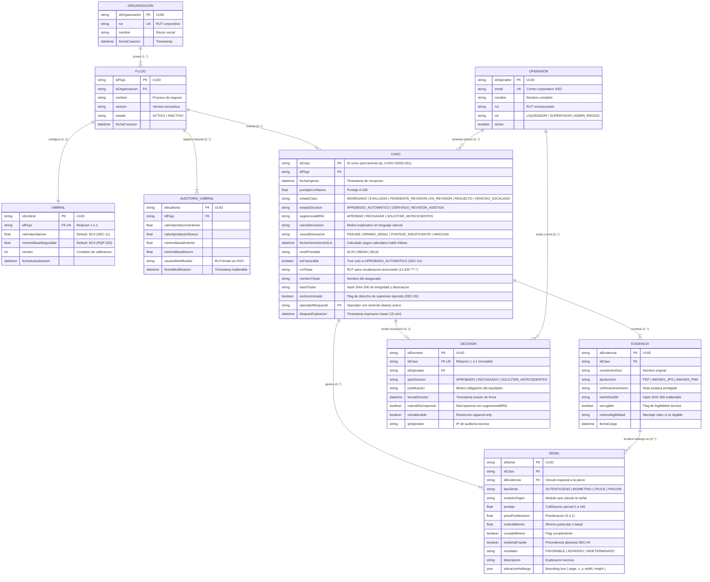
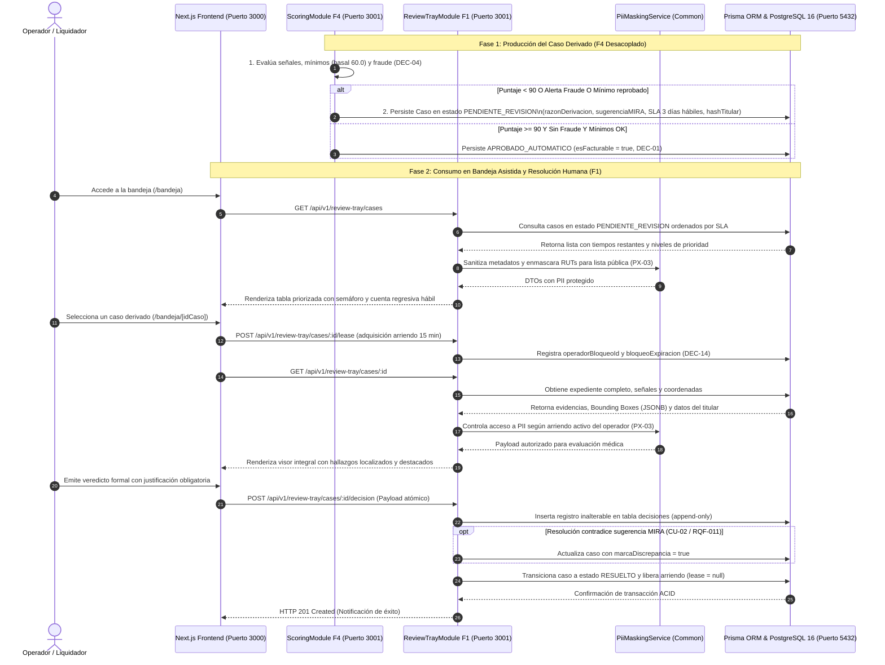

# Evolución de Diagramas y Requerimientos de Persistencia (E1 -> E2)
**Proyecto:** Plataforma MIRA — DPRIME SpA  
**Entrega:** Entrega 2  
**Fecha:** 17 de Octubre de 2026  
**Autores / Revisores:** Dante Chávez, Nikolas Lagos (Representante del Cliente), Franko Moraga y Felipe Caru  
**Artefactos Técnicos de Referencia:**
- [Plan de Implementación Técnica (`specs/001-bandeja-revision-asistida/plan.md`)](../../specs/001-bandeja-revision-asistida/plan.md)
- [Modelo de Datos y Prisma Schema (`specs/001-bandeja-revision-asistida/data-model.md`)](../../specs/001-bandeja-revision-asistida/data-model.md)
- [Especificación F1 (`specs/001-bandeja-revision-asistida/spec.md`)](../../specs/001-bandeja-revision-asistida/spec.md)
- [Especificación F4 (`specs/002-puntaje-decision-umbrales/spec.md`)](../../specs/002-puntaje-decision-umbrales/spec.md)

---

## 1. Introducción y Contexto de la Evolución Arquitectural

En la **Entrega 1** (`docs/entrega1/LLMS.docx` y `docs/entrega1/prueba.md`), los artefactos de diseño se formularon a nivel de **análisis conceptual de negocio**:
1. Un **Modelo de Dominio Conceptual** simplificado con 8 entidades clave (`Organizacion`, `Flujo`, `Umbral`, `Modulo`, `Caso`, `Evidencia`, `Senal`, `Decision`, `Operador`).
2. Un **Diagrama de Secuencia Conceptual** para el caso de uso `CU-02 (Revisar Caso Asistido)` que representaba a la plataforma como una caja negra monolítica (`MIRA`) interactuando con el operador.

Al avanzar a la **Entrega 2** bajo el flujo **Spec-Driven Development (SDD)** y generar el **Plan Técnico de Implementación** (`/speckit-plan`), fue imperativo transformar estos diagramas abstractos en **diseños de ingeniería ejecutables**. Esto exigió resolver requerimientos estrictos de persistencia relacional en PostgreSQL 16 con Prisma ORM, control transaccional ACID, concurrencia multiusuario, auditoría forense inalterable y desacoplamiento modular en NestJS (separando el productor `ScoringModule` [F4] del consumidor `ReviewTrayModule` [F1]).

Este documento resume exhaustivamente las transformaciones que experimentaron los diagramas, los nuevos atributos y entidades exigidos por la persistencia, y la comparativa técnica entre la visión conceptual de la Entrega 1 y la arquitectura física de la Entrega 2.

---

## 2. Cambios en el Modelo de Dominio y Diagrama Entidad-Relación

### 2.1 Modelo de Dominio Conceptual (Entrega 1)
En la Entrega 1, el modelo se limitaba a representar las relaciones esenciales sin atributos técnicos de persistencia:
- `Organizacion` (idOrganizacion, nombre, rut) $1 \dots *$ $\to$ `Flujo` (idFlujo, nombre, estado).
- `Flujo` $1 \dots 1$ $\to$ `Umbral` (valorAprobacion, valorRevision).
- `Flujo` $0 \dots *$ $\to$ `Modulo` (nombre, version, activo).
- `Flujo` $0 \dots *$ $\to$ `Caso` (idCaso, fechaIngreso, puntajeConfianza, estadoDecision).
- `Caso` $1 \dots *$ $\to$ `Evidencia` (idEvidencia, tipoArchivo).
- `Caso` $0 \dots *$ $\to$ `Senal` (tipoSenal, resultado).
- `Caso` $1 \dots 1$ $\to$ `Decision` (tipoDecision, justificacion, fecha).
- `Decision` $0 \dots 1$ registrada por $\to$ `Operador` (nombre, rol).

### 2.2 Diagrama Entidad-Relación Físico (Entrega 2 - Implementación Relacional)
En la Entrega 2, el modelo evolucionó a un esquema relacional fuertemente tipado en Prisma ORM sobre PostgreSQL 16:

---

## 3. Matriz Exhaustiva de Entidades y Atributos Nuevos por Requerimiento Técnico

La siguiente tabla resume todos los atributos y entidades nuevos que surgieron exclusivamente al descender al diseño de implementación y persistencia, detallando la justificación técnica que la Entrega 1 omitió por ser conceptual:

| Entidad | Atributos en E1 | Atributos / Entidades Nuevos en E2 | Tipo de Dato | Justificación Técnica de Persistencia / Implementación |
| :--- | :--- | :--- | :--- | :--- |
| **Caso** | `idCaso`, `fechaIngreso`, `puntajeConfianza`, `estadoDecision` | `estadoCaso` | Enum (`INGRESADO`, `EVALUADO`, `PENDIENTE_REVISION`, `EN_REVISION`, `RESUELTO`, `VENCIDO_ESCALADO`) | **Ciclo de vida interno:** E1 solo tenía "estadoDecision" o "Resuelto". La máquina requiere gestionar transiciones asíncronas entre la ingesta, la evaluación de scoring, la toma en bandeja humana y el vencimiento de SLA. |
| **Caso** | — | `sugerenciaMIRA` | Enum (`APROBAR`, `RECHAZAR`, `SOLICITAR_ANTECEDENTES`) | **Trazabilidad de discrepancia:** Si el backend no persiste el veredicto preliminar de la IA antes de la intervención humana, es imposible evaluar deterministamente si el liquidador contradijo al modelo (`RQF-011`). |
| **Caso** | — | `razonDerivacion` | String | **Explicabilidad en UI:** Requiere almacenar un texto explicativo amigable para el operador en pantalla única (`RQF-009`, §2.7), evitando calcularlo dinámicamente en cada render. |
| **Caso** | — | `causalDerivacion` | Enum (`FRAUDE`, `MINIMO_SENAL`, `PUNTAJE_INSUFICIENTE`, `NINGUNA`) | **Jerarquía resolutiva:** Implementación de la regla estricta de precedencia (`RQF-023`) para filtros rápidos de backend y direccionamiento a liquidadores especializados en fraude. |
| **Caso** | — | `fechaVencimientoSLA` | DateTime | **Control temporal hábil:** Timestamp absoluto precalculado al ingresar el caso, aplicando el calendario laborable de Chile (3 días hábiles de 08:30 a 18:30 hrs) para alertas tempranas (`RQF-021`, DEC-13). |
| **Caso** | — | `nivelPrioridad` | Enum (`ALTA`, `MEDIA`, `BAJA`) | **Ordenamiento de bandeja:** Indexación en base de datos para ordenar la lista de trabajo por urgencia y riesgo en menos de 2 segundos (`RQF-024`, `RQNF-008`). |
| **Caso** | — | `esFacturable` | Boolean | **Integridad comercial:** Flag booleano indexable para reportes de facturación; garantiza que solo las aprobaciones automáticas concluyentes generen cobro (`DEC-01`, `RQF-015`). |
| **Caso** | — | `rutTitular`, `nombreTitular` | String, String | **Protección de PII y visualización autorizada:** Almacenamiento local de datos del asegurado protegidos, entregados sin enmascarar únicamente al liquidador con arriendo activo y enmascarados en logs/vistas públicas (`DEC-06`, `RQNF-003`, `PX-03`). |
| **Caso** | — | `hashTitular`, `esAnonimizado` | String, Boolean | **Reconciliación con Derecho de Supresión:** Hash SHA-256 inmutable para trazabilidad y flag de supresión ejercida (`DEC-05`, Principio IV). Permite anonimizar los nombres del asegurado sin destruir la auditoría histórica. |
| **Caso** | — | `operadorBloqueoId`, `bloqueoExpiracion` | String (FK), DateTime | **Concurrencia y arriendo (lease):** Implementa el protocolo de concurrencia híbrida (`DEC-14`, `RQF-024`). Evita *race conditions* garantizando arriendos de 15 min con renovación por *heartbeat*. |
| **Caso** | — | `idFlujo` | String (FK UUID) | **Clave foránea relacional:** Integridad referencial con la versión específica del flujo bajo la cual se tramitó el expediente. |
| **Senal** | `tipoSenal`, `resultado` | `idSenal`, `idCaso`, `idEvidencia` | String (UUID PK y FKs) | **Claves técnicas y relación espacial:** E1 no vinculaba la señal a un archivo concreto. `idEvidencia` es indispensable para que el visor abra la imagen exacta donde ocurrió el hallazgo (`RQF-020`). |
| **Senal** | — | `puntaje`, `pesoPonderacion`, `moduloOrigen` | Float, Float, String | **Auditoría del scoring:** Desglose cuantitativo del aporte de cada módulo analítico al puntaje global (0–100) exigido por `RQF-004`. |
| **Senal** | — | `umbralMinimo`, `cumpleMinimo` | Float, Boolean | **Control de mínimos basales:** Persiste el piso exigido (basal de 60.0 o calibrado) para verificar la condición de derivación por señal reprobada (`RQF-022`). |
| **Senal** | — | `esAlertaFraude` | Boolean | **Bandera de precedencia:** Permite al motor de reglas indexar y consultar instantáneamente si existe fraude activo (`DEC-04`, `RQF-023`). |
| **Senal** | — | `ubicacionHallazgo` | JSONB (`{ page, x, y, width, height }`) | **Coordenadas espaciales (Bounding Box):** Datos geométricos necesarios para que el visor en Next.js dibuje los recuadros de resaltado sobre documentos o imágenes (`RQF-020`, ENT5). |
| **Senal** | — | `descripcion` | String | **Detalle del hallazgo:** Texto que describe la anomalía técnica encontrada en el archivo (ej. "Monto alterado digitalmente"). |
| **Evidencia** | `idEvidencia`, `tipoArchivo` | `nombreArchivo`, `fechaCarga` | String, DateTime | **Metadatos de ingesta:** Nombre original del archivo para presentación en UI y marca temporal de recepción. |
| **Evidencia** | — | `urlAlmacenamiento` | String | **Ruta estática física:** Ubicación protegida en el volumen de almacenamiento Docker para servicio estático local (`DEC-06`). |
| **Evidencia** | — | `hashSha256` | String | **Integridad criptográfica:** Hash inalterable para verificar que la evidencia no ha sido corrompida ni alterada durante su ciclo de vida (`RQNF-004`, `DEC-03`). |
| **Evidencia** | — | `esLegible`, `motivoIlegibilidad` | Boolean, String | **Validación previa de formato:** Soporta el camino de excepción de CU-01 (`RQF-002`) sin abortar el procesamiento del resto del expediente. |
| **Decision** | `tipoDecision`, `justificacion`, `fecha` | `idDecision`, `idCaso`, `idOperador` | String (UUID PK y FKs) | **Integridad referencial y unicidad:** Relación 1 a 1 estricta con el caso; vinculación con la identidad SSO del operador firmante. |
| **Decision** | — | `marcaDiscrepancia` | Boolean | **Bandera para reentrenamiento:** Almacena de forma persistente si la resolución contradijo la sugerencia de MIRA (`RQF-011`, CU-02). |
| **Decision** | — | `esInalterable` | Boolean (Default: true) | **Restricción append-only:** Salvaguarda técnica a nivel de base de datos que bloquea sentencias `UPDATE` o `DELETE` (`RQNF-005`, `DEC-05`, `PX-05`). |
| **Decision** | — | `ipOperador` | String | **Trazabilidad forense:** Dirección IP del cliente que confirma la resolución para auditoría legal. |
| **Umbral** | `valorAprobacion`, `valorRevision` | `minimoBasalSeguridad` | Float (Default: 60.0) | **Eliminación de `valorRevision` y adición de mínimo basal:** `valorRevision` se descartó por incompatibilidad con `DEC-04`. Se agregó el piso basal de 60 puntos (`RQF-022`, `DEC-11`). |
| **Umbral** | — | `version`, `fechaActualizacion` | Int, DateTime | **No retroactividad:** Permite que casos en curso continúen evaluándose con la versión de umbral con la que iniciaron (§3). |
| **AuditoriaUmbral** | *(No existía en E1)* | `idAuditoria`, `idFlujo`, valores anteriores y nuevos, `usuarioModificador`, `fechaModificacion` | Entidad Completa (Tabla relacional dedicada) | **Registro histórico inmutable:** E1 solo mencionaba en texto "registrar autor y fecha". La implementación física exigió una tabla histórica inalterable (`RQF-006`, `RQNF-005`). |
| **Operador** | `nombre`, `rol` | `idOperador`, `email`, `rut`, `activo` | UUID, String Unique, String, Boolean | **Seguridad corporativa y SSO:** Soporte de autenticación federada SAML/OAuth2 (`DEC-09`) y almacenamiento de RUT enmascarado (`DEC-06`). |
| **Flujo** y **Organizacion** | Conceptuales | UUIDs PK/FK, `version` semántica, timestamps `fechaCreacion` | UUIDs, Strings, DateTimes | **Aislamiento multi-tenant y versionamiento:** Soporte de múltiples organizaciones clientes con esquemas de versionado semántico independiente. |

---

## 4. Cambios en los Diagramas de Secuencia (CU-02 E1 -> Plan Técnico E2)

### 4.1 Diagrama de Secuencia Conceptual (Entrega 1)
En la Entrega 1, el diagrama de secuencia de `CU-02 (Revisar Caso Asistido)` modelaba una interacción simplificada de 3 pasos:
1. `Operador` $\to$ `MIRA`: `seleccionarCaso(idCaso)`
2. `MIRA` $\to$ `Operador`: `mostrarEvidenciaYRazonDerivacion(evidencia, puntaje, senales, motivo)`
3. `Operador` $\to$ `MIRA`: `emitirVeredicto(idCaso, decision, motivo)`
   - Bloque `alt`: Si coincide con sugerencia de MIRA, ejecuta `registrarDecisionInalterable()` y `confirmarRegistro(idCaso, estado: "Resuelto")`.
   - Si difiere de la sugerencia, ejecuta `registrarDecisionInalterable()`, `marcarParaRevisionDeModelos(idCaso)` y `confirmarRegistro(idCaso, estado: "Resuelto", marca: "Discrepancia")`.

### 4.2 Diagrama de Secuencia Técnico Multicapa (Entrega 2)
Al bajar a la arquitectura física en Docker con NestJS, Next.js y Prisma, el flujo se transformó en un **protocolo desacoplado de dos fases** (Productor F4 $\to$ Base de Datos $\to$ Consumidor F1), con control estricto de concurrencia y persistencia ACID:

---

## 5. Cambios en la Arquitectura de Componentes y Contenedores

La Entrega 1 concebía a MIRA como un bloque monolítico único. En la Entrega 2, el Plan Técnico formalizó la **Arquitectura de Contenedores en Docker Compose**, dividiendo el sistema en tres contenedores especializados comunicados sobre una red interna segura (`mira-network`):

1. **Contenedor Frontend (`mira-frontend`)**:
   - Next.js 14 (App Router con Server Components RSC).
   - Divide la experiencia en tres vistas: `/configuracion` (Admin/Ingesta y calibración de umbrales), `/bandeja` (lista priorizada de casos) y `/bandeja/[idCaso]` (visor integral con visor de *bounding boxes* interactivo).
   - Cumple `RQNF-008` (tiempos de carga < 2 segundos).
2. **Contenedor Backend (`mira-backend`)**:
   - NestJS v10 modular.
   - **`ScoringModule` (F4)**: Encapsula el cálculo de scoring, calibración de umbrales y aplicación de reglas de negocio (`DEC-04`, `DEC-11`, `RQF-022`, `RQF-023`). Actúa como **productor** de expedientes evaluados.
   - **`ReviewTrayModule` (F1)**: Encapsula la gestión de la bandeja, cómputo de SLA en horas hábiles laborables (`DEC-13`), protocolo de concurrencia híbrida (`DEC-14`) y servicio de resoluciones inalterables. Actúa como **consumidor**.
   - **`CommonModule` (Transversal y Seguridad PII)**: Provee `PiiMaskingService` para enmascaramiento determinista de RUTs y nombres (`DEC-06`, `PX-03`), `ChileanCalendarUtil` para cómputo de SLA en jornada laborable chilena (`DEC-13`) y `HttpExceptionFilter` para sanitización global de excepciones y logs.
   - **`StaticFilesService`**: Servidor de archivos mock local para servir evidencias ficticias (PDFs e imágenes) sin exponer datos personales al exterior (`DEC-06`).
   - **`PrismaModule`**: Capa de abstracción relacional con tipado estático y garantía de transacciones ACID.
3. **Contenedor Base de Datos (`mira-db`)**:
   - PostgreSQL 16 Alpine con almacenamiento persistente en volumen Docker (`pgdata`).
   - Gobernado por el esquema declarativo `schema.prisma`.

---

## 6. Conclusión y Síntesis de la Evolución

El paso del modelo conceptual de la Entrega 1 al diseño técnico de la Entrega 2 demostró que:
1. **La persistencia relacional no tolera estados implícitos**: Requirió tipar 6 estados de ciclo de vida (`estadoCaso`), flags de facturación comercial (`DEC-01`), timestamps de calendario hábil (`DEC-13`) y estructuras JSONB espaciales (`RQF-020`).
2. **La inalterabilidad exige diseño append-only físico**: La promesa legal de auditoría (`DEC-05`, `RQNF-005`) se tradujo en tablas dedicadas inmutables (`AuditoriaUmbral` y `Decision`) con prohibición expresa de modificaciones.
3. **La concurrencia real invalida la interacción lineal**: La presencia de múltiples liquidadores obligó a crear mecanismos de arriendo temporal (*lease*) con expiración automática para salvaguardar la integridad de los expedientes.
