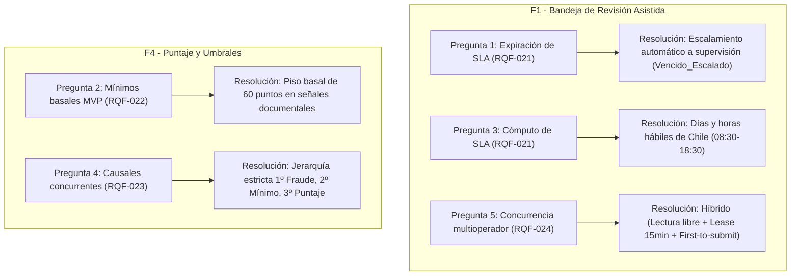

# Informe de Decisiones y Proceso de Clarificación (CLARIFY)
**Proyecto:** Plataforma MIRA — DPRIME SpA  
**Entrega:** Entrega 2  
**Fecha:** 17 de Octubre de 2026  
**Autores / Revisores:** Dante Chávez, Nikolas Lagos (Representante del Cliente), Franko Moraga y Felipe Caru  
**Proceso:** Sesión interactiva `/speckit-clarify` sobre funcionalidades `F1` y `F4`

---

## 1. Introducción y Propósito

El flujo **Spec-Driven Development (SDD)** contempla que, una vez redactadas las especificaciones técnicas iniciales, se debe someter el diseño a una fase de desambiguación y clarificación rigurosa (`/speckit-clarify`). El objetivo es detectar vacíos en reglas de negocio, zonas grises en la experiencia de usuario o inconsistencias operativas antes de iniciar la descomposición en tareas de ingeniería e implementación.

Durante la sesión de clarificación de la Entrega 2, el agente analizó en profundidad las fuentes primarias ([docs/entrega1/Descripción del proyecto.docx](../entrega1/Descripci%C3%B3n%20del%20proyecto.docx) y [docs/entrega1/LLMS.docx](../entrega1/LLMS.docx)), contrastándolas contra la [Constitución de MIRA](../../.specify/memory/constitution.md) y los nuevos requisitos funcionales (`RQF-020` a `RQF-024`).

Este documento registra:
1. Las 5 preguntas estructuradas formuladas por el agente, sus citas textuales, opciones y resoluciones dictadas por el Representante del Cliente.
2. El análisis de las ambigüedades que el agente resolvió por su cuenta y su alineación con el cliente.
3. La tabla unificada de impacto en las Decisiones de Negocio y Arquitectura (`DEC-01` a `DEC-14`), incorporando las nuevas fichas de decisión en el formato estándar de gobernanza.

---

## 2. Las 5 Preguntas de Clarificación y Citas Textuales

A continuación se documentan las 5 interrogantes de clarificación presentadas durante la sesión interactiva, con el detalle de las fuentes citadas, las alternativas evaluadas y la decisión adoptada por el Representante del Cliente:



---

### Pregunta 1: Acción operativa por defecto ante vencimiento del SLA sin resolución
* **Requisito Afectado:** `RQF-021` (Alerta de vencimiento y tiempo restante) en `F1 - Bandeja de revisión asistida`.
* **Interrogante del Agente:** *¿Cuál debe ser la acción operativa por defecto que ejecute la plataforma cuando un caso derivado en la bandeja de revisión asistida exceda el plazo límite de resolución (SLA) sin que ningún operador haya emitido su decisión?*
* **Por qué importaba:** El documento original advertía que un caso no resuelto no puede quedar en el limbo ni cerrarse arbitrariamente, lo que violaría normativas de la Comisión para el Mercado Financiero (CMF) y el Principio II de la Constitución (control humano y no rechazo automático).
* **Citas Textuales de Fuentes:**
  > - **`Descripción del proyecto.docx` — §3**: *"Ningún caso puede quedar sin resolución. Un caso está resuelto cuando se aprobó, se rechazó, se derivó y un operador decidió, o se cerró por falta de antecedentes tras el plazo definido por el cliente... El cliente decide qué se hace con los casos que exceden el plazo de resolución sin que nadie los revise: cerrarlos, escalarlos o mantenerlos abiertos."*  
  > - **`Descripción del proyecto.docx` — §2.15 y ENT4**: *"Al supervisor le corresponde enterarse cuando la bandeja crece por sobre lo habitual o cuando un caso lleva demasiado tiempo sin que nadie lo tome... Si un caso queda detenido esperando que alguien lo mire, necesito verlo antes de que se me venza, no después."*  
  > - **`LLMS.docx` — Principio II / DEC-04**: *"El sistema NUNCA DEBE emitir rechazos 100% automáticos sobre casos de personas... Jamás podrá quedar un caso rechazado sin intervención humana resolutiva."*
* **Opciones Presentadas:**
  - **A (Recomendada):** Escalar automáticamente el caso a una cola de supervisión con estado `Vencido_Escalado` y notificar al supervisor de siniestros.
  - **B:** Mantener el caso en la bandeja general con estado visual crítico `Plazo_Vencido` e incremento de prioridad, sin reasignación.
  - **C:** Reasignar automáticamente el caso al operador disponible con menor carga activa de trabajo y emitir alerta de contingencia.
  - **D:** Bloquear temporalmente la asignación de nuevos casos al operador responsable y notificar a la jefatura de operaciones.
* **Respuesta del Cliente:** **Opción A**.
* **Impacto en la Especificación:** Incorporado en `specs/001-bandeja-revision-asistida/spec.md`:
  - En la sección `## Clarificaciones`.
  - En la Historia de Usuario 3 (Escenario de Aceptación 3).
  - En la matriz de requisitos `RQF-021`, el caso de prueba `PF-21` y el enumerado de la entidad `AlertaVencimientoSLA`.

---

### Pregunta 2: Mínimos basales de seguridad por señal en el flujo del MVP médico
* **Requisito Afectado:** `RQF-022` (Mínimos individuales por señal) en `F4 - Puntaje y decisión por umbrales`.
* **Interrogante del Agente:** *¿Cómo debe operar el motor de decisión respecto a los valores mínimos por señal (RQF-022) en el flujo del MVP médico cuando el cliente piloto aún no ha configurado valores personalizados en el diseñador de flujos?*
* **Por qué importaba:** Si la plataforma operaba sin mínimos basales (mínimo = 0), un siniestro con falsificación o alteración documental grosera podía resultar aprobado de forma 100% automática si las otras señales promediaban sobre 90 puntos, materializando la advertencia del líder de ingeniería en ENT3.
* **Citas Textuales de Fuentes:**
  > - **`Descripción del proyecto.docx` — §2.6**: *"Cuando el puntaje sea suficiente pero alguna señal individual esté por debajo de su mínimo, el caso debe derivarse a revisión aunque el total lo permita. El detalle de qué señales tienen mínimo propio y cuáles son sus valores está pendiente de definir con el área de riesgo del cliente piloto... Los valores de referencia son: sobre 85, el caso se aprueba automáticamente... bajo 60, se escala o se rechaza por riesgo alto."*  
  > - **`Descripción del proyecto.docx` — ENT3 (Sebastián Alarcón)**: *"Un número entre cero y cien esconde que las señales miden cosas distintas. Un ochenta y siete por documentos perfectos y biometría regular no es lo mismo que un ochenta y siete por todo mediocre... Por eso insisto en los mínimos por señal, aunque nadie ha definido cuáles son."*  
  > - **`LLMS.docx` — DEC-11 (anexo)**: *"Para el piloto, el umbral de aprobación automática es de 90 puntos."*
* **Opciones Presentadas:**
  - **A (Recomendada):** Aplicar un mínimo basal de seguridad de 60 puntos a las señales críticas de documentos en el MVP, editable por el Administrador de Riesgo.
  - **B:** Operar sin mínimos por señal por defecto (mínimo = 0), evaluando exclusivamente el puntaje total hasta que el cliente configure mínimos explícitos.
  - **C:** Bloquear la publicación de cualquier flujo si el Administrador de Riesgo no ha definido manualmente los mínimos de cada señal activa.
  - **D:** Asignar automáticamente como mínimo basal el umbral global de aprobación menos 20 puntos.
* **Respuesta del Cliente:** **Opción A**.
* **Impacto en la Especificación:** Incorporado en `specs/002-puntaje-decision-umbrales/spec.md`:
  - En la sección `## Clarificaciones`.
  - En la Historia de Usuario 3 (Escenario de Aceptación 2).
  - En los Casos Borde y Excepciones, la matriz `RQF-022` y la entidad de dominio `UmbralFlujo`.

---

### Pregunta 3: Algoritmo de cómputo del tiempo restante de SLA (Horario Hábil vs. Continuo)
* **Requisito Afectado:** `RQF-021` (Cómputo y alerta de SLA) en `F1 - Bandeja de revisión asistida`.
* **Interrogante del Agente:** *¿Cómo debe computarse el tiempo restante y la cuenta regresiva del SLA para los casos derivados en la bandeja de revisión asistida?*
* **Por qué importaba:** Si el cálculo corría en tiempo cronológico 24/7 sin considerar días inhábiles, un expediente ingresado un viernes por la tarde consumía su plazo durante el fin de semana, emitiendo falsas alertas de vencimiento y escalamientos indebidos antes de que el personal de operaciones iniciara la jornada laboral el lunes.
* **Citas Textuales de Fuentes:**
  > - **`Descripción del proyecto.docx` — ENT4 (Francisca Leiva)**: *"Tenemos comprometidos cinco días hábiles con el asegurado, pero la comisión del mercado nos mide en tres. Internamente trabajamos con tres días. Si un caso queda detenido esperando que alguien lo mire, necesito verlo antes de que se me venza, no después."*  
  > - **`Descripción del proyecto.docx` — §2.7**: *"Un caso derivado a revisión debe resolverse dentro del plazo comprometido por el cliente con sus propios asegurados, de modo que la plataforma debe mostrar el tiempo restante y alertar cuando un caso lleve demasiado tiempo detenido."*  
  > - **`Descripción del proyecto.docx` — §2.15**: *"Al operador le corresponde saber cuándo entró un caso a su bandeja y cuándo un caso está por vencer el plazo comprometido."*
* **Opciones Presentadas:**
  - **A (Recomendada):** Computar el SLA en días y horas hábiles laborables (lunes a viernes 08:30–18:30 hrs), pausando en fines de semana y feriados nacionales de Chile.
  - **B:** Computar el SLA en tiempo cronológico corrido continuo (24/7), sin pausar en fines de semana ni feriados.
  - **C:** Computar el SLA en días hábiles completos de 24 horas (lunes a viernes completos), pausando exclusivamente sábados, domingos y feriados.
  - **D:** Hacer parametrizable por cliente si el cálculo de SLA descuenta fines de semana/feriados o si corre en tiempo continuo 24/7.
* **Respuesta del Cliente:** **Opción A**.
* **Impacto en la Especificación:** Incorporado en `specs/001-bandeja-revision-asistida/spec.md`:
  - En la sección `## Clarificaciones`.
  - En los Casos Borde y Excepciones.
  - En la matriz `RQF-021`, la entidad `AlertaVencimientoSLA` y el Criterio de Éxito `SC-006`.

---

### Pregunta 4: Jerarquía formal ante múltiples causales concurrentes de derivación
* **Requisito Afectado:** `RQF-023` (Precedencia de fraude) en `F4 - Puntaje y decisión por umbrales`.
* **Interrogante del Agente:** *¿Cuál debe ser la jerarquía y estado resolutivo formal cuando un caso evaluado presente simultáneamente múltiples causales de derivación (por ejemplo, alerta de fraude activa, incumplimiento de un mínimo por señal y puntaje global bajo el umbral)?*
* **Por qué importaba:** El sistema debe asignar un único estado formal primario para clasificar el expediente en la bandeja, dirigirlo a liquidadores especializados en fraude si corresponde y permitir una auditoría estadística limpia sobre las causas de rechazo o derivación.
* **Citas Textuales de Fuentes:**
  > - **`Descripción del proyecto.docx` — §3**: *"Las señales de fraude tienen precedencia sobre el puntaje total. Un caso con una señal de fraude activa se deriva o se escala, cualquiera sea su puntaje."*  
  > - **`Descripción del proyecto.docx` — §2.6**: *"Cuando el puntaje sea suficiente pero alguna señal individual esté por debajo de su mínimo, el caso debe derivarse a revisión aunque el total lo permita."*  
  > - **`Descripción del proyecto.docx` — §2.7**: *"El operador debe ver, en una sola pantalla, la evidencia del caso, el puntaje obtenido, el desglose de las señales y —sobre todo— la razón por la cual el caso fue derivado."*  
  > - **`LLMS.docx` — Principio II / DEC-04 y RQF-023**: *"Aplicar la regla de precedencia absoluta a las señales de fraude sobre el puntaje total, de modo que cualquier señal de fraude activa inhabilite la aprobación automática y obligue a la derivación a revisión humana o escalamiento, independientemente del puntaje calculado."*
* **Opciones Presentadas:**
  - **A (Recomendada):** Jerarquía estricta: 1º Fraude, 2º Mínimo de señal, 3º Puntaje global; asignando el estado de la causal más crítica e incluyendo todas las causales en el desglose explicativo.
  - **B:** Asignar un estado genérico unificado `Derivado_A_Revision_Humana` acompañado de una lista de todas las causales activas sin jerarquización.
  - **C:** Generar estados combinados específicos para cada concurrencia (ej. `Derivado_Fraude_Y_Puntaje`).
  - **D:** Priorizar el factor con mayor desvío numérico relativo respecto a su umbral de aprobación.
* **Respuesta del Cliente:** **Opción A**.
* **Impacto en la Especificación:** Incorporado en `specs/002-puntaje-decision-umbrales/spec.md`:
  - En la sección `## Clarificaciones`.
  - En los Casos Borde y Excepciones.
  - En la matriz `RQF-023` y la entidad `DecisionResultante` (`Derivado_A_Revision_Humana_Fraude` como prioridad 1).

---

### Pregunta 5: Política de expiración y concurrencia multioperador en la bandeja
* **Requisito Afectado:** `RQF-024` (Lista de trabajo y gestión de casos en bandeja) en `F1 - Bandeja de revisión asistida`.
* **Interrogante del Agente:** *¿Cuál debe ser la política de expiración y liberación del bloqueo temporal de edición cuando un operador toma y abre un caso derivado en la bandeja de revisión asistida?*
* **Por qué importaba:** Sin un protocolo de concurrencia definido, dos operadores podían emitir veredictos contradictorios simultáneos (*race conditions*), o bien un caso urgente podía quedar secuestrado si un analista abría el expediente y abandonaba la sesión sin liberar el bloqueo.
* **Citas Textuales de Fuentes:**
  > - **`Descripción del proyecto.docx` — §2.7**: *"Los casos que no se resuelven solos llegan a una bandeja de trabajo. Esta parte del producto casi no existe hoy y es, según el cliente piloto, la que decide si la plataforma se usa o no."*  
  > - **`Descripción del proyecto.docx` — §2.15 y ENT4**: *"Al supervisor le corresponde enterarse cuando la bandeja crece por sobre lo habitual o cuando un caso lleva demasiado tiempo sin que nadie lo tome... Si un caso queda detenido esperando que alguien lo mire, necesito verlo antes de que se me venza, no después."*  
  > - **`LLMS.docx` — RQF-024**: *"Proveer una interfaz de lista de trabajo en la bandeja de revisión asistida que presente los casos derivados asignables, ordenados por prioridad y tiempo restante de resolución, permitiendo al operador seleccionar y gestionar casos individuales."*
* **Opciones Presentadas:**
  - **A (Recomendada por Agente):** Bloqueo temporal de 15 minutos renovable por actividad (*heartbeat*), liberándose automáticamente tras 15 minutos de inactividad o abandono de sesión.
  - **B:** Bloqueo persistente exclusivo por operador hasta confirmación o liberación explícita.
  - **C:** Acceso concurrente libre en modo lectura, aplicando bloqueo solo en el instante de confirmación (*first to submit wins*).
  - **D:** Bloqueo temporal rígido de 30 minutos sin renovación automática.
* **Respuesta del Cliente:** **"Combinar A y C" (Intervención humana activa)**.
* **Impacto en la Especificación:** Incorporado en `specs/001-bandeja-revision-asistida/spec.md`:
  - En la sección `## Clarificaciones`.
  - En los Casos Borde y Excepciones (diseño de arquitectura híbrida).
  - En la matriz `RQF-024`, el caso de prueba `PF-24` y el atributo `bloqueoEdicion` de la entidad `Caso`.

---

## 3. Ambigüedades que el Agente Intentó Resolver Autónomamente

Durante el proceso, el agente identificó ambigüedades e intentó resolverlas o propuso soluciones que reflejaban sesgos de diseño de software estándar. A continuación se analiza cuáles coincidían con el criterio del Representante del Cliente y cuáles debieron ser corregidas o redirigidas:

| Ambigüedad Identificada | Solución Intentada por el Agente (Inicial) | Criterio del Representante del Cliente | ¿Coincidía? | Medida Adoptada |
| :--- | :--- | :--- | :---: | :--- |
| **Régimen temporal del SLA** | Asumió un cronómetro continuo 24/7 en el borrador inicial de `RQF-021`. | El SLA contractual y la fiscalización de la CMF rigen exclusivamente en días y horas hábiles laborables chilenos. | **NO COINCIDÍA** | Se rechazó la premisa continua; se fijó horario de lunes a viernes de 08:30 a 18:30 hrs, excluyendo festivos de Chile. |
| **Modelo de bloqueo de expedientes** | Propuso bloqueo monousuario exclusivo en la interfaz de trabajo (Opción A en Q5). | Los supervisores y analistas deben poder ver la evidencia simultáneamente para consultas técnicas, reservando el bloqueo solo para la decisión. | **NO COINCIDÍA (Parcial)** | Se instruyó combinar A y C: lectura concurrente irrestricta con arriendo (*lease*) de edición de 15 min y confirmación atómica *first-to-submit*. |
| **Clasificación ante fallas simultáneas** | Planteó una precedencia estricta donde Fraude predomina sobre mínimos y puntaje. | Fraude es la mayor severidad de riesgo y requiere peritaje especializado; debe primar en el rótulo del caso. | **SÍ COINCIDÍA** | Se formalizó el enumerado `Derivado_A_Revision_Humana_Fraude` como causal primaria, conservando el resto en la traza analítica. |
| **Piso de seguridad sin calibración** | Sugirió un mínimo basal de 60 puntos para señales documentales basándose en rangos históricos de §2.6. | Ningún reembolso médico puede aprobarse si las facturas o boletas tienen dudas sustanciales, aun con biometría perfecta. | **SÍ COINCIDÍA** | Se ratificó el piso basal de 60 puntos editable por el Administrador de Riesgo. |
| **Comportamiento ante SLA vencido** | Planteó escalamiento a supervisión en lugar de cierre o desestimación del caso. | Normativa de protección al asegurado prohíbe cerrar o rechazar expedientes de clientes por fallas operativas internas. | **SÍ COINCIDÍA** | Se ratificó la transición a estado `Vencido_Escalado` y despacho de alerta prioritaria al supervisor. |

---

## 4. Matriz Unificada de Decisiones (DEC-01 a DEC-14)

Como resultado directo de la sesión de clarificación y del análisis de impacto sobre la bitácora formal de [docs/entrega1/LLMS.docx](../entrega1/LLMS.docx), se consolidó la siguiente matriz de decisiones del proyecto:

| ID Decisión | Asunto / Principio Rector | Estado en Entrega 2 | Detalle del Impacto y Relación con Preguntas |
| :--- | :--- | :--- | :--- |
| **DEC-01** | Cobro exclusivo por validaciones automáticas concluyentes | **Intacta (Sin cambios)** | Se mantiene la regla comercial: 0% de cobro sobre casos derivados a F1 (`SC-006` en F4). |
| **DEC-02** | Escalabilidad y tramos tarifarios para >15.000 casos/mes | **Intacta (Sin cambios)** | Aplica a dimensionamiento de infraestructura y configuración de tramos. |
| **DEC-03** | Retención de evidencia por capas (90 días activa, 5 años fría) | **Intacta (Sin cambios)** | Aplica a las políticas de almacenamiento de la evidencia visualizada en F1. |
| **DEC-04** | Control humano estricto y prohibición de rechazo automático | **MODIFICADA / AMPLIADA** | **Ampliación por Q1 y Q4**: Al vencer el SLA el sistema tampoco puede emitir un cierre desestimatorio (se escala a supervisión); ante causales concurrentes, Fraude prima como causal primaria sin generar rechazo automático. |
| **DEC-05** | Anonimización de PII e inalterabilidad de la traza técnica | **Intacta (Sin cambios)** | Se mantiene para solicitudes de derecho de supresión de datos personales. |
| **DEC-06** | Soberanía territorial de datos y enmascaramiento local de PII | **Intacta (Sin cambios)** | Se mantiene para el consumo seguro de modelos de frontera. |
| **DEC-07** | Ingesta asíncrona con acuse `HTTP 202` en < 1 segundo | **Intacta (Sin cambios)** | Aplica a la API de entrada de expedientes. |
| **DEC-08** | Adaptador desacoplado para carpeta compartida legacy | **Intacta (Sin cambios)** | Mantiene la interoperabilidad con sistemas centrales heredados. |
| **DEC-09** | Autenticación corporativa federada vía SSO (SAML/OAuth2) | **Intacta (Sin cambios)** | Rige el inicio de sesión y la firma digital de auditoría de operadores en F1 y F4. |
| **DEC-10** | Estrategia de entrega: MVP médico (Enero 2027) y multimodal (Abril 2027) | **Intacta (Sin cambios)** | Ambas especificaciones (`F1` y `F4`) se circunscribieron estrictamente al MVP médico. |
| **DEC-11** | Parametrización y calibración de umbrales por flujo | **MODIFICADA / AMPLIADA** | **Ampliación por Q2**: Se ratificó el umbral global de 90 puntos y se formalizó el **piso basal de seguridad de 60 puntos** para señales documentales críticas en el MVP médico (`RQF-022`). |
| **DEC-12** | Endpoint de consulta activa de estado (pull) complementario | **Intacta (Sin cambios)** | Salvaguarda de consulta ante fallos de entrega de webhooks. |
| **DEC-13** | Cómputo de SLA en días y horas hábiles con escalamiento automático | **NUEVA DECISIÓN CREADA** | **Originada por Q1 y Q3**: Formaliza el cálculo de SLA en horario laboral hábil chileno y el escalamiento contingente por vencimiento (`RQF-021`). |
| **DEC-14** | Protocolo de concurrencia híbrida y arriendo de edición (*lease*) en bandeja | **NUEVA DECISIÓN CREADA** | **Originada por Q5**: Formaliza la lectura concurrente multiusuario con arriendo de edición de 15 min renovable y confirmación atómica *first-to-submit* (`RQF-024`). |

---

## 5. Fichas Formales de las Nuevas Decisiones (`DEC-13` y `DEC-14`)

Siguiendo la estructura formal de registro de decisiones consagrada en [docs/entrega1/LLMS.docx](../entrega1/LLMS.docx), se formalizan a continuación las dos nuevas decisiones técnicas y de negocio ratificadas por el Representante del Cliente:

```text
================================================================================
DEC-13: Cómputo del SLA de revisión asistida en días y horas hábiles laborables
        con escalamiento automático por vencimiento
================================================================================
ID: DEC-13
Fecha: 17-10-2026
Asunto: Regla de cálculo cronológico para el temporizador de SLA de casos derivados y
        definición de la acción operativa de escalamiento ante expiración del plazo.
Contexto: 
Las secciones §2.7 y §2.15 de la documentación fundacional exigen monitorear el tiempo
restante de resolución y alertar el estancamiento de expedientes en bandeja. La sección
§3 contempla expresamente que el cliente define qué se hace con los casos que exceden
el plazo de resolución sin que nadie los revise (cerrarlos, escalarlos o mantenerlos
abiertos). La entrevista ENT4 (Francisca Leiva, Subgerenta de Operaciones) precisa que
la aseguradora compromete plazos en días hábiles con el asegurado (5 días) y que la
comisión del mercado financiero (CMF) mide a la entidad internamente en 3 días hábiles.
No existía en el diseño una definición unívoca de si el temporizador corría en tiempo
cronológico continuo (24/7) ni cuál era la acción de contingencia por defecto al vencer
el tiempo límite.

Alternativas Evaluadas:
(a) Computar el SLA en tiempo cronológico corrido continuo (24/7) y mantener el caso
    abierto en la bandeja general con alerta visual crítica tras el vencimiento.
(b) Computar el SLA en días y horas hábiles laborables (lunes a viernes de 08:30 a 
    18:30 hrs, excluyendo sábados, domingos y feriados oficiales de Chile) y escalar
    automáticamente a una cola de supervisión con estado "Vencido_Escalado" y notificación
    inmediata al supervisor de siniestros.
(c) Reasignar automáticamente el caso vencido al operador disponible con menor carga.

Decisión Adoptada:
Alternativa (b) — El temporizador de SLA computa estrictamente el tiempo hábil laborable
de la aseguradora en Chile (pausando noches, fines de semana y festivos oficiales). Si un
caso alcanza su plazo límite sin decisión de un liquidador, el sistema no emite ningún
cierre o rechazo automático desestimatorio (salvaguardando el Principio II de la
Constitución); en su lugar, transiciona de forma autónoma al estado "Vencido_Escalado",
se transfiere con máxima prioridad a la cola de supervisión y despacha una notificación
de contingencia al supervisor de siniestros.

Justificación:
Previene la emisión de alertas falsas y escalamientos improcedentes fuera del horario de
oficina, alinea el software con la jornada real de los liquidadores y con los estándares
fiscalizables de la CMF, e impide que expedientes de asegurados sean perjudicados o
rechazados por retrasos operativos internos de la compañía.

Impacto en el Sistema:
- Especificación: F1 - Bandeja de revisión asistida (specs/001-bandeja-revision-asistida/spec.md).
- Requisitos: RQF-021.
- Casos de Uso y Pruebas: CU-02, PF-21.
- Modelo de Datos: Entidad AlertaVencimientoSLA (estados: En_Plazo, Proximo_A_Vencer, Vencido_Escalado).
- Criterios de Éxito: SC-006.
================================================================================
```

```text
================================================================================
DEC-14: Protocolo de concurrencia híbrida y arriendo temporal de edición (lease)
        en la bandeja de revisión asistida multioperador
================================================================================
ID: DEC-14
Fecha: 17-10-2026
Asunto: Mecanismo de control de concurrencia, bloqueo transaccional temporal y prevención
        de colisiones de resolución entre múltiples operadores en la bandeja de trabajo.
Contexto:
La sección §2.7 y la entrevista ENT5 subrayan que la bandeja de trabajo es el corazón
operativo que define si la plataforma MIRA es adoptada con éxito por los liquidadores.
En un entorno operativo con decenas de operadores y supervisores concurrentes, si varios
usuarios abren el mismo expediente simultáneamente surge el riesgo crítico de resoluciones
incompatibles en paralelo (race conditions). Por otro lado, un esquema de bloqueo rígido
monousuario secuestraría expedientes si un operador olvida la pestaña abierta o se ausenta,
acercando el caso al vencimiento del SLA sin posibilidad de intervención de terceros.
Ningún documento preliminar especificaba la arquitectura transaccional de concurrencia.

Alternativas Evaluadas:
(a) Bloqueo exclusivo temporal por operador de 15 minutos renovable por pulso de actividad
    (heartbeat), impidiendo la lectura a otros usuarios mientras esté bloqueado.
(b) Lectura concurrente libre sin bloqueos, aplicando una regla simple de "última
    escritura gana" (last-write-wins).
(c) Acceso concurrente en lectura y bloqueo únicamente en el instante de presionar el
    botón resolutivo ("first-to-submit-wins").
(d) Esquema híbrido (combinación A y C): lectura concurrente multiusuario permitida para
    consulta e inspección colaborativa de evidencia, arriendo temporal de edición (lease)
    de 15 minutos renovable por heartbeat que se adquiere únicamente cuando un operador
    comienza a redactar el veredicto resolutivo, liberación automática tras 15 minutos de
    inactividad o abandono de sesión, y persistencia atómica con bloqueo optimista final.

Decisión Adoptada:
Alternativa (d) — Implementar el protocolo de concurrencia híbrida. Múltiples operadores
pueden inspeccionar concurrentemente la evidencia y señales en modo lectura. Al accionar
el panel de resolución formal, el operador adquiere un arriendo temporal (lease) de 15 min
respaldado por un heartbeat periódico del cliente web. Otros operadores que visualicen
el caso verán una advertencia de "Edición activa por otro operador". Si el operador se
mantiene inactivo durante 15 minutos o cierra el navegador, el lease expira de inmediato y
el caso retorna libremente al pool general. La confirmación final de resolución es atómica
(first-to-submit), rechazando colisiones y garantizando la inalterabilidad transaccional.

Justificación:
Concilia la agilidad operativa y la colaboración entre analistas y supervisores con la
estricta seguridad transaccional requerida por el negocio asegurador. Evita el bloqueo
indebido de casos urgentes por abandono de puesto y elimina por completo el riesgo de
resoluciones duplicadas o inconsistentes ante auditorías legales.

Impacto en el Sistema:
- Especificación: F1 - Bandeja de revisión asistida (specs/001-bandeja-revision-asistida/spec.md).
- Requisitos: RQF-024.
- Casos de Uso y Pruebas: CU-02, PF-24.
- Modelo de Datos: Entidad Caso (atributos de concurrencia: bloqueoEdicion con usuarioId,
  timestamp, expiracionLease).
- Arquitectura de Software: Módulo de control de concurrencia en backend y gestión de
  latidos (heartbeats) en el frontend.
================================================================================
```
