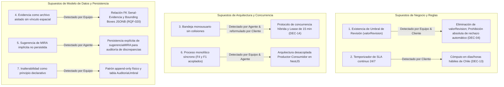

# Registro de Supuestos Invalidados al Descender al Diseño Técnico
**Proyecto:** Plataforma MIRA — DPRIME SpA  
**Entrega:** Entrega 2  
**Fecha:** 17 de Octubre de 2026  
**Autores / Revisores:** Dante Chávez, Nikolas Lagos (Representante del Cliente), Franko Moraga y Felipe Caru  
**Artefactos Técnicos de Referencia:**
- [Plan de Implementación Técnica (`specs/001-bandeja-revision-asistida/plan.md`)](../../specs/001-bandeja-revision-asistida/plan.md)
- [Modelo de Datos y Prisma Schema (`specs/001-bandeja-revision-asistida/data-model.md`)](../../specs/001-bandeja-revision-asistida/data-model.md)
- [Bitácora de Decisiones y Clarificación (`docs/entrega2/clarificacion_cambios.md`)](clarificacion_cambios.md)

---

## 1. Introducción

El paso desde un **modelo de análisis conceptual** (desarrollado en la Entrega 1) hacia un **diseño técnico de ingeniería ejecutable** (desarrollado en la Entrega 2 mediante Spec-Driven Development) es un punto crítico en el ciclo de vida del software. En esta transición, las abstracciones y omisiones del modelo conceptual se enfrentan a las restricciones reales de la arquitectura: persistencia relacional ACID, transacciones concurrentes, protocolos de red, interfaces de usuario interactivas y normativas regulatorias imperativas.

Durante la construcción del **Plan Técnico** de las funcionalidades `F1` (Bandeja de revisión asistida) y `F4` (Puntaje y decisión por umbrales), **7 supuestos centrales de la Entrega 1 quedaron formalmente invalidados o colapsaron**.

Este documento registra cada uno de estos supuestos, explicando qué se asumía originalmente en la Entrega 1, por qué la realidad técnica lo desestimó, qué solución de ingeniería se implementó en su reemplazo y **quién detectó la discrepancia** (el Equipo Humano de Ingeniería, el Agente de IA o el Representante del Cliente).

---

## 2. Resumen Ejecutivo de Supuestos Invalidados

---

## 3. Fichas Detalladas de Supuestos Invalidados

---

### Supuesto 1: Existencia de un umbral inferior de revisión (`valorRevision` en E1)

* **Supuesto en la Entrega 1:**
  En el Modelo de Dominio de la Entrega 1, la entidad `Umbral` se definió con dos atributos numéricos: `valorAprobacion` y `valorRevision`. Asimismo, la sección §2.6 del levantamiento inicial indicaba que *"sobre 85 puntos se aprueba automáticamente, entre 60 y 84 se deriva a revisión humana, y bajo 60 se escala o se rechaza por riesgo alto"*, asumiendo que existía un puntaje mínimo por debajo del cual el sistema emitía un rechazo automático sin intervención humana.
* **Por qué se invalidó al bajar al diseño técnico:**
  Al confrontar este modelo con la [Constitución de MIRA](../../.specify/memory/constitution.md) y la decisión `DEC-04`, se constató una incompatibilidad legal insalvable: **MIRA tiene prohibido categóricamente emitir rechazos 100% automáticos sobre siniestros de personas**. Por lo tanto, no existe un "umbral de corte inferior": absolutamente todo caso cuyo puntaje sea inferior al umbral de aprobación automática (fijado en 90 puntos por `DEC-11`), o que presente señales de fraude o mínimos incumplidos, DEBE derivarse a revisión asistida. Mantener `valorRevision` en la base de datos habría inducido a programar una rama de rechazo automático en el motor de reglas.
* **Quién lo detectó:**
  **El Equipo de Ingeniería y el Representante del Cliente** durante el alineamiento constitucional de la Entrega 2.
* **Solución técnica adoptada en E2:**
  Se eliminó el atributo `valorRevision` del esquema `schema.prisma`. En su lugar, la entidad `Umbral` incorporó `minimoBasalSeguridad` (Float, 60.0 por defecto según `RQF-022`) para gobernar las señales individuales, y el motor `DecisionRulesEngine` en `ScoringModule` se programó para transicionar únicamente a `APROBADO_AUTOMATICO` o `PENDIENTE_REVISION`, garantizando 0% de rechazos automáticos (`SC-002`).

---

### Supuesto 2: El temporizador de SLA corre en tiempo cronológico corrido continuo (24/7)

* **Supuesto en la Entrega 1:**
  La Entrega 1 identificó la necesidad de alertar el vencimiento de compromisos con el asegurado (SLA interno de 3 días / externo de 5 días según ENT4 y §2.7), pero concibió el tiempo restante de forma abstracta. Al iniciar el diseño técnico, el agente asumió un cronómetro continuo estándar de 24 horas al día, 7 días a la semana.
* **Por qué se invalidó al bajar al diseño técnico:**
  Un cálculo continuo en el backend implicaba que un expediente ingresado un viernes a las 18:00 hrs agotaría más de 48 horas durante el fin de semana, disparando falsas alertas de "Vencimiento Inminente" en domingo y transicionando automáticamente a `Vencido_Escalado` cuando la aseguradora no tiene operadores en funciones. Además, la Comisión para el Mercado Financiero (CMF) fiscaliza los plazos exclusivamente en días hábiles laborables.
* **Quién lo detectó:**
  **El Representante del Cliente (Nikolas Lagos)** en la sesión interactiva de clarificación (`/speckit-clarify`, Pregunta 3), sustentándose en el testimonio operativo de Francisca Leiva (ENT4).
* **Solución técnica adoptada en E2:**
  Se formalizó la decisión **`DEC-13`**. En el backend NestJS (`ReviewTrayService`), el cálculo de `fechaVencimientoSLA` se implementó mediante un algoritmo de calendario hábil que computa lapsos de lunes a viernes de 08:30 a 18:30 hrs, congelando la cuenta regresiva durante noches, fines de semana y feriados oficiales de Chile (`RQF-021`).

---

### Supuesto 3: La bandeja de revisión asistida es monousuario y libre de colisiones concurrentes

* **Supuesto en la Entrega 1:**
  El diagrama de secuencia conceptual de `CU-02 (Revisar Caso Asistido)` modelaba un flujo lineal aislado: *"El operador selecciona un caso de la lista, MIRA muestra la información y el operador emite su veredicto"*. No se contemplaba la existencia de múltiples operadores interactuando concurrentemente sobre el mismo conjunto de expedientes.
* **Por qué se invalidó al bajar al diseño técnico:**
  En una operación real con decenas de liquidadores concurrentes en Next.js, surge el riesgo inminente de *race conditions*: dos operadores abren el mismo caso derivado en paralelo y emiten decisiones conflictivas (ej. uno aprueba y otro rechaza). Asimismo, un bloqueo rígido por operador secuestraría expedientes si un liquidador abre un caso y cierra la pestaña del navegador sin resolver, llevando el caso al vencimiento involuntario.
* **Quién lo detectó:**
  **El Agente de IA** levantó la alerta arquitectural de colisiones en la Pregunta 5 de clarificación; **el Representante del Cliente** corrigió la propuesta inicial del agente (que sugería bloqueo rígido monousuario) e instruyó implementar un esquema híbrido.
* **Solución técnica adoptada en E2:**
  Se formalizó la decisión **`DEC-14`** y se ampliaron los atributos de `Caso` en Prisma (`operadorBloqueoId` y `bloqueoExpiracion`). La arquitectura técnica implementó:
  1. Lectura multiusuario libre para consulta colaborativa.
  2. Arriendo temporal de edición (*lease*) de 15 minutos renovable por *heartbeat* al accionar el panel de veredicto.
  3. Liberación automática ante 15 minutos de inactividad o cierre de sesión.
  4. Confirmación atómica de resolución (*first-to-submit*) con bloqueo optimista en base de datos (`PF-24`, `RQF-024`).

---

### Supuesto 4: La evidencia es un archivo adjunto genérico desvinculado de las señales analíticas

* **Supuesto en la Entrega 1:**
  En el modelo conceptual de E1, la entidad `Evidencia` contenía solo `idEvidencia` y `tipoArchivo`, mientras que `Senal` era una entidad agregada del caso con `tipoSenal` y `resultado` como textos genéricos. No existía relación estructural entre una señal de hallazgo y una pieza de evidencia específica.
* **Por qué se invalidó al bajar al diseño técnico:**
  Al aterrizar la interfaz de usuario en Next.js y el requerimiento `RQF-020` (basado en la entrevista ENT5 con Marco Peñailillo: *"si la máquina dice que el total es ciento veinte mil, quiero ver dónde lo leyó, apretar ahí y que me lleve al pedazo de la boleta"*), fue evidente que el operador no puede recibir señales flotantes sin anclaje visual. El visor interactivo requiere que cada hallazgo esté rígidamente enlazado a un archivo y contenga coordenadas espaciales vectoriales exactas.
* **Quién lo detectó:**
  **El Equipo de Ingeniería** al diseñar los componentes de frontend (`VisorIntegralCaso`) y los contratos REST de `ReviewTrayModule`.
* **Solución técnica adoptada en E2:**
  Se transformó el esquema relacional en Prisma:
  - Se creó una clave foránea explícita `idEvidencia` dentro de `Senal`.
  - Se incorporó el atributo `ubicacionHallazgo` en formato `JSONB` conteniendo la geometría vectorial del hallazgo (`{ page, x, y, width, height }`).
  - Se incorporó `hashSha256` en `Evidencia` para certificar la integridad criptográfica inalterable del archivo (`RQNF-004`).

---

### Supuesto 5: La sugerencia analítica de MIRA es implícita y no requiere persistencia física

* **Supuesto en la Entrega 1:**
  El diagrama de secuencia de `CU-02` en E1 establecía que si el veredicto del operador contradecía la recomendación de MIRA, el sistema debía marcar el caso con `Discrepancia` (`RQF-011`). Sin embargo, el modelo de datos de E1 no contemplaba ningún campo donde se guardara formalmente qué había sugerido MIRA antes de la llegada del operador.
* **Por qué se invalidó al bajar al diseño técnico:**
  En una arquitectura desacoplada basada en microservicios o módulos independientes en NestJS, el operador revisa el caso horas o días después de que el motor de evaluación ejecutó su análisis. Si la recomendación original de MIRA no se persiste de manera inmutable en el caso, el backend de resolución (`ResolutionService`) tendría que reejecutar todo el motor de scoring (simulado o de IA) para adivinar qué recomendó la máquina, arriesgando inconsistencias o fallos de auditoría.
* **Quién lo detectó:**
  **El Agente de IA** al redactar la especificación de contratos de endpoints en el Plan Técnico y modelar los DTOs de resolución.
* **Solución técnica adoptada en E2:**
  Se incorporó en la entidad `Caso` el atributo enumerado `sugerenciaMIRA` (`APROBAR`, `RECHAZAR`, `SOLICITAR_ANTECEDENTES`), asignado obligatoriamente por `ScoringModule` al persistir la evaluación. Cuando el liquidador emite su veredicto en `POST /api/v1/review-tray/cases/:id/decision`, el backend compara atómicamente `tipoDecision` con `sugerenciaMIRA` y fija `marcaDiscrepancia = true` de forma determinista y auditable.

---

### Supuesto 6: F4 (Scoring) y F1 (Bandeja) forman un único proceso síncrono monolítico

* **Supuesto en la Entrega 1:**
  El levantamiento de la Entrega 1 describía el ciclo de vida del siniestro como una secuencia lineal indivisible: un expediente ingresa, se evalúa de inmediato y, si no aprueba, se despliega en pantalla para revisión.
* **Por qué se invalidó al bajar al diseño técnico:**
  Al diseñar la implementación modular en NestJS y Docker, mantener acoplada la evaluación analítica con la gestión de la bandeja violaba el principio de responsabilidad única (SRP), impedía la ingesta masiva asíncrona (`HTTP 202` en < 1 segundo según `DEC-07` / `RQNF-001`) y hacía imposible que la bandeja operara como un *pool* de trabajo persistente e independiente de los motores de análisis.
* **Quién lo detectó:**
  **El Equipo de Ingeniería y el Agente de IA** al plantear la arquitectura modular en NestJS (`ScoringModule` vs. `ReviewTrayModule`).
* **Solución técnica adoptada en E2:**
  Se estableció una arquitectura desacoplada basada en el patrón **Productor-Consumidor**:
  - `ScoringModule` (F4) actúa como **productor asíncrono**: evalúa las reglas, calcula el puntaje y persiste el caso con estado `PENDIENTE_REVISION` en PostgreSQL.
  - `ReviewTrayModule` (F1) actúa como **consumidor interactivo**: consulta casos pendientes, gestiona arriendos de concurrencia y procesa las decisiones humanas de forma totalmente independiente del ciclo de vida del scoring.

---

### Supuesto 7: La inalterabilidad de la auditoría se satisface con un mandato declarativo

* **Supuesto en la Entrega 1:**
  La Entrega 1 consagraba el requisito `RQNF-005` y la decisión `DEC-05` indicando que *"el rastro de auditoría debe ser inalterable para todo perfil, incluido el administrador"*. En el modelo conceptual, esto se representaba como una simple promesa textual en el flujo de `CU-02`.
* **Por qué se invalidó al bajar al diseño técnico:**
  A nivel de bases de datos relacionales y APIs REST, un mandato declarativo no protege la base de datos contra sentencias `UPDATE` o `DELETE` accidentales o maliciosas ejecutadas por ORMs o endpoints administrativos. La inalterabilidad requerida por la CMF y la normativa legal exige que la persistencia física sea estructuralmente inmutable (*append-only*).
* **Quién lo detectó:**
  **El Equipo de Ingeniería** al estructurar el modelo de datos relacional y las pruebas extrafuncionales de auditoría (`PX-05`).
* **Solución técnica adoptada en E2:**
  1. Se diseñaron las tablas `Decision` y `AuditoriaUmbral` como modelos puramente **Append-Only**, suprimiendo deliberadamente cualquier endpoint o servicio que exponga métodos `PUT`, `PATCH` o `DELETE` sobre ellas.
  2. Se incorporó el atributo `esInalterable = true` por defecto en `Decision`.
  3. Se diseñó la prueba automatizada `PX-05` en Jest/Supertest para verificar que cualquier intento de modificación o borrado retorne un error `HTTP 403 Forbidden` / `HTTP 405 Method Not Allowed`, registrando el intento en la bitácora técnica de seguridad.

---

## 4. Matriz Resumen de Detección y Responsabilidad

| # | Supuesto Invalidado de la Entrega 1 | Quién lo Detectó | Causa Raíz de la Invalidación | Artefacto de Corrección en E2 |
| :-: | :--- | :--- | :--- | :--- |
| **1** | Existencia de `valorRevision` y rechazo automático inferior | **Equipo de Ingeniería & Representante del Cliente** | Violación del Principio II y `DEC-04` (prohibición de rechazo automático a personas). | `specs/001-bandeja-revision-asistida/data-model.md` |
| **2** | Temporizador de SLA continuo 24/7 | **Representante del Cliente** | Desalineación con la jornada real de aseguradora (ENT4) y normas CMF en días hábiles. | `DEC-13` / `RQF-021` en `plan.md` |
| **3** | Bandeja monousuario libre de colisiones | **Agente de IA (Alerta) & Representante del Cliente (Solución)** | *Race conditions* entre liquidadores y secuestro de expedientes por abandono de sesión. | `DEC-14` / `RQF-024` en `plan.md` |
| **4** | Evidencia como archivo aislado sin vínculo espacial | **Equipo de Ingeniería** | Imposibilidad técnica de enfocar hallazgos vectoriales en pantalla única (`RQF-020`, ENT5). | Relación `Senal.idEvidencia` y JSONB en `data-model.md` |
| **5** | Sugerencia de MIRA implícita no persistida | **Agente de IA** | Imposibilidad de evaluar discrepancias de modelo (`RQF-011`) en llamadas REST asíncronas. | Atributo `sugerenciaMIRA` en `Caso` |
| **6** | Flujo monolítico síncrono acoplado (F4 y F1) | **Equipo de Ingeniería & Agente de IA** | Acoplamiento excesivo y violación de tiempos de respuesta asíncronos (`DEC-07`). | Arquitectura modular NestJS en `plan.md` |
| **7** | Inalterabilidad como principio declarativo | **Equipo de Ingeniería** | Falta de garantías físicas contra sentencias `UPDATE`/`DELETE` en PostgreSQL/Prisma. | Patrón Append-Only físico y `PX-05` |

---

## 5. Conclusiones y Aprendizajes de Ingeniería

La experiencia de confrontar los modelos conceptuales de la Entrega 1 con el rigor de la implementación física de la Entrega 2 deja tres lecciones fundamentales para la ingeniería conducida por agentes:

1. **La colaboración tripartita (Equipo - Agente - Cliente) es indispensable:** El Agente de IA aportó agudeza arquitectural para detectar problemas de concurrencia y asincronía en las APIs; el Cliente aportó la visión operativa y legal indispensable para corregir calendarios y políticas de bloqueo; y el Equipo de Ingeniería aportó la solidez técnica para estructurar bases de datos inalterables y desacoplar componentes.
2. **Los modelos conceptuales ocultan complejidad transaccional:** Atributos como estados del ciclo de vida (`estadoCaso`), flags de auditoría (`marcaDiscrepancia`), hashes criptográficos y arriendos temporales (*leases*) no son "detalles de bajo nivel", sino requerimientos de primer orden que condicionan el éxito o fracaso del producto ante los usuarios y entes reguladores.
3. **El enfoque Spec-Driven Development previene costosos refactorings:** Detectar y documentar estos 7 supuestos invalidados durante la fase de especificación y planificación evitó reescribir miles de líneas de código NestJS y Next.js en fases posteriores de desarrollo.
