# Decisiones de diseño del sistema multiagente

## 1. Alternativa, caso y herramienta
- **Alternativa:** A · Desarrollo de software conducido por especificación.
- **Caso:** motor de decisión de un caso analizado de MIRA: calcula el puntaje, decide si se aprueba, se deriva a revisión o se rechaza, la señal de fraude prima sobre todo y cada cliente tiene sus propios umbrales. La necesidad textual está en `docs/trabajo/01-necesidad.md`.
- **Por qué este caso:** es acotado (un módulo y una API), tiene reglas que se prueban con casos concretos y contiene ambigüedades reales frente a las fuentes de las entregas anteriores (por ejemplo, "rechazo automático" frente a DEC-04), que obligan a usar el punto de aclaración con el cliente.
- **Herramienta:** Claude Code (extensión de VS Code), con agentes en `.claude/agents/` y skills en `.claude/skills/`, equivalentes a `.github/agents/` y `.github/skills/` que el enunciado acepta. Modelo de los agentes: Claude Sonnet (`model: sonnet`). Versión: 2.1.302.
- **Representante del cliente:** Nikolas Lagos. Repite el rol de las entregas 1 a 3 con autorización del profesor; la excepción a la regla de rotación (enunciado 4.5) queda registrada aquí y en la bitácora.

## 2. Patrón de coordinación
**Patrón principal:** secuencial (encadenamiento) con traspaso humano entre etapas, más un ciclo evaluador-optimizador entre desarrollador y revisor con un máximo de 2 vueltas.

```mermaid
flowchart LR
  N[01-necesidad.md<br/>cliente] --> A[analista]
  A -->|02-especificacion.md| H1{{Cliente: aclaraciones<br/>03-aclaraciones.md}}
  H1 --> A2[analista<br/>2da pasada]
  A2 -->|02-especificacion.md| H2{{Cliente: aprueba spec<br/>commit CLIENTE}}
  H2 --> P[planificador]
  P -->|04-plan.md| H3{{Equipo: aprueba plan<br/>control extra}}
  H3 --> D[desarrollador]
  D -->|05-implementacion-N.md<br/>src/ tests/| R[revisor]
  R -->|06-revision-N.md: CAMBIOS<br/>máx. 2 vueltas| D
  R -->|APROBADO o ESCALAR| H4{{Cliente: aceptación<br/>07-aceptacion.md}}
```

**Por qué se ajusta al caso.** El flujo de la alternativa A tiene etapas fijas y conocidas (especificar, aclarar, planificar, implementar, revisar), y cada una consume el artefacto de la anterior. Un error temprano se arrastra, por eso entre etapas hay compuertas humanas. La única parte iterativa es la corrección del código, que se resuelve con un evaluador (revisor) que devuelve al generador (desarrollador) contra criterios explícitos: los AC.

**Patrón descartado: orquestador con trabajadores (subagentes).**
- *Costo:* el orquestador sería un modelo más que relee todo el contexto en cada delegación; en la alternativa A las subtareas ya se conocen de antemano, así que la decisión dinámica de qué delegar no aporta.
- *Riesgo:* el orquestador puede saltarse la aprobación de la especificación o resumir mal un traspaso (pérdida de contexto, MAST de desalineación). Con archivos fijos en `docs/trabajo/` cada agente lee la fuente completa.
- *Control:* las compuertas obligatorias (aprobar la spec antes del código) quedan en manos de una persona y no dependen de que un modelo decida detenerse.
- *Restricción de la herramienta:* en Claude Code un subagente no puede invocar a otro subagente, de modo que un orquestador como agente no puede delegar; la coordinación la hace la sesión principal operada por una persona.

**También se descartó la paralelización**, porque las etapas dependen unas de otras y no hay subtareas independientes.

## 3. Agentes
| Agente | Rol | Herramientas | Entrada | Salida | Criterio de término | Skills |
|---|---|---|---|---|---|---|
| analista | Historia G/W/T, caso de uso y ambigüedades | Read, Grep, Glob, Write | 01-necesidad.md, 03-aclaraciones.md | 02-especificacion.md | Todos los AC con ID y G/W/T; preguntas abiertas listadas o cerradas | historia-gwt |
| planificador | Diseño, contrato de API y tareas | Read, Grep, Glob, Write | 02-especificacion.md aprobada | 04-plan.md | Cada AC en la matriz con al menos una prueba | — |
| desarrollador | Código y pruebas | Read, Grep, Glob, Write, Edit, Bash | 04-plan.md, 06-revision-(N-1).md | src/, tests/, 05-implementacion-N.md | Pruebas en verde y ningún AC sin prueba, o fallas declaradas | verificador-trazabilidad |
| revisor | Juzga el código contra la spec | Read, Grep, Glob, Write | 02, 04 y 05-implementacion-N.md | 06-revision-N.md | Veredicto por AC con evidencia y veredicto global | revision-contra-spec |

## 4. Justificación de herramientas de escritura y ejecución
- **Write en analista, planificador y revisor:** cada uno debe dejar su archivo de traspaso en `docs/trabajo/` (requisito 4.3 del enunciado). Ninguno tiene **Edit** ni **Bash**: no pueden modificar archivos existentes de otros ni ejecutar comandos. El cuerpo de cada agente restringe Write a un único archivo; después de cada etapa se comprueba con `git diff --stat` que solo cambió ese archivo.
- **Revisor sin Edit ni Bash:** la regla de la alternativa A dice que el agente que revisa no puede editar archivos. Se interpreta como que no puede modificar código, pruebas, especificación ni plan; solo crea su propio informe. Tampoco ejecuta pruebas: toma como evidencia la salida que pega el desarrollador, y si no coincide con el código lo reporta como hallazgo.
- **Edit y Bash solo en el desarrollador:** es el único que modifica código y necesita ejecutar pytest y el script del verificador de trazabilidad para demostrar su criterio de término. Su cuerpo prohíbe git, borrados y red.

## 5. Puntos de control humano
| # | Punto | Quién | Qué revisa | Registro |
|---|---|---|---|---|
| H1 | Aclaraciones | Representante del cliente | Preguntas [NEEDS CLARIFICATION] del analista | 03-aclaraciones.md, commit [CLIENTE] |
| H2 | Aprobación de la especificación (obligatorio en A) | Representante del cliente | AC, caso de uso y fuentes de cada regla | Commit [CLIENTE] Aprueba especificación |
| H3 | Aprobación del plan (control extra) | Equipo | Diseño, contrato de API y matriz AC → prueba | Nota en bitácora y commit [EQUIPO] |
| H4 | Aceptación final | Representante del cliente | Informe del revisor y pruebas en verde | 07-aceptacion.md, commit [CLIENTE] |

**Por qué H3 es necesario:** en la Entrega 2 el plan generado fue el artefacto más largo y el menos revisado. Aprobar el plan antes del código evita que el desarrollador implemente una decisión de diseño que nadie validó.

## 6. Ciclos y límites
- Aclaraciones con el cliente: máximo 2 rondas.
- Desarrollador ↔ revisor: máximo 2 vueltas. Si la vuelta 2 termina en CAMBIOS, el revisor escribe ESCALAR A HUMANO y decide el representante del cliente.

## 7. Skills
| Skill | Procedimiento que encapsula | Por qué es skill y no parte del agente | Recurso nivel 3 |
|---|---|---|---|
| historia-gwt | Plantilla de historia, AC Given/When/Then y caso de uso | Es un formato reutilizable en cualquier historia, no una responsabilidad del analista | Plantilla |
| verificador-trazabilidad | Comprobar que cada AC tiene prueba y tarea | Es un procedimiento mecánico y repetible que se resuelve mejor con código determinista | Script Python |
| revision-contra-spec | Rúbrica binaria por AC y formato del informe | La misma rúbrica sirve para cualquier revisión contra spec | Plantilla de informe |
