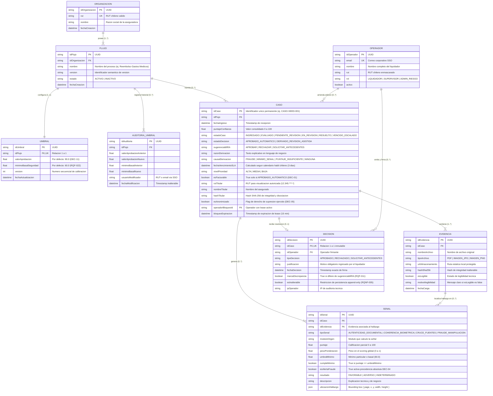
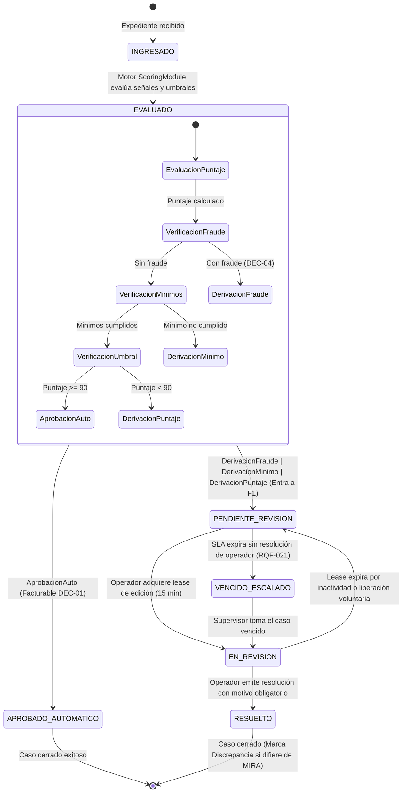

# Modelo de Datos y Evolución de Entidades (Fase 1)

**Funcionalidad**: F4 - Puntaje y decisión por umbrales & F1 - Bandeja de revisión asistida  
**Rama**: `002-puntaje-decision-umbrales`  
**Fecha**: 2026-10-17  
**Estado**: Consolidado  

---

## 1. Evolución del Modelo de Dominio (E1 -> E2)

### 1.1 Diagrama de Entidad-Relación (Mermaid E2)



---

## 2. Tabla Comparativa de Entidades y Atributos (E1 -> E2)

| Entidad | Atributo E1 | Atributo Nuevo en E2 | Tipo de Dato | Propósito Operativo y Trazabilidad de Requisito |
| :--- | :--- | :--- | :--- | :--- |
| **Caso** | `idCaso`, `fechaIngreso`, `puntajeConfianza`, `estadoDecision` | `sugerenciaMIRA` | Enum (`APROBAR`, `RECHAZAR`, `SOLICITAR_ANTECEDENTES`) | Registra la recomendación analítica del motor MIRA para contrastarla con la decisión humana (CU-02, RQF-011). |
| **Caso** | — | `razonDerivacion` | String | Explicación en lenguaje natural comprensible que indica por qué el caso no se aprobó solo (RQF-009, §2.7). |
| **Caso** | — | `causalDerivacion` | Enum (`FRAUDE`, `MINIMO_SENAL`, `PUNTAJE_INSUFICIENTE`, `NINGUNA`) | Jerarquía formal de precedencia de derivación según RQF-023. |
| **Caso** | — | `fechaVencimientoSLA` | DateTime | Plazo perentorio de 3 días hábiles computado en días laborables de Chile (RQF-021, ENT4). |
| **Caso** | — | `nivelPrioridad` | Enum (`ALTA`, `MEDIA`, `BAJA`) | Priorización en bandeja: casos con fraude o SLA inminente pasan a `ALTA` (RQF-024). |
| **Caso** | — | `esFacturable` | Boolean | Facturación comercial única por aprobación automática concluyente (DEC-01, RQF-015). |
| **Caso** | — | `rutTitular`, `nombreTitular` | String, String | Datos personales protegidos para visualización autorizada por el liquidador (DEC-06, RQNF-003). |
| **Caso** | — | `hashTitular`, `esAnonimizado` | String, Boolean | Mecanismo de disociación y trazabilidad inalterable para derecho de supresión de datos (DEC-05, Principio IV). |
| **Caso** | — | `operadorBloqueoId`, `bloqueoExpiracion` | String, DateTime | Control de concurrencia híbrido mediante lease temporal de edición de 15 min (RQF-024). |
| **Senal** | `tipoSenal`, `resultado` | `esAlertaFraude` | Boolean | Bandera que activa la regla de precedencia absoluta de fraude sobre el puntaje (DEC-04, RQF-023). |
| **Senal** | — | `puntaje`, `pesoPonderacion` | Float, Float | Componente cuantitativo del puntaje de confianza ponderado (RQF-004). |
| **Senal** | — | `umbralMinimo`, `cumpleMinimo` | Float, Boolean | Control de mínimos individuales por señal (basal 60.0 en MVP) conforme a RQF-022. |
| **Senal** | — | `ubicacionHallazgo` | JSONB (`{ page, x, y, width, height }`) | Coordenadas espaciales del hallazgo para enfoque y resaltado visual en visor (RQF-020). |
| **Senal** | — | `idEvidencia` | String (FK a Evidencia) | Vincula la señal al archivo específico del expediente donde se localizó el hallazgo (RQF-020). |
| **Decision** | `tipoDecision`, `justificacion`, `fecha` | `marcaDiscrepancia` | Boolean | Bandera automática de discrepancia para revisión por el equipo de modelos (RQF-011, CU-02). |
| **Decision** | — | `esInalterable` | Boolean (Default: true) | Salvaguarda de inmutabilidad append-only para auditoría regulatoria (DEC-05, RQNF-005, PX-05). |
| **Umbral** | `valorAprobacion`, `valorRevision` | `minimoBasalSeguridad` | Float (Default: 60.0) | Mínimo de seguridad para señales documentales del MVP (RQF-022, DEC-11). |
| **Umbral** | — | `version` | Int | Control de no retroactividad y versionado inmutable de calibraciones (§3). |
| **AuditoriaUmbral** | *(Nueva entidad)* | `id`, `flujoId`, valores, usuario, fecha | Entidad Completa | Trazabilidad histórica inalterable de cada modificación de umbral (RQF-006, RQNF-005). |
| **Evidencia** | `idEvidencia`, `tipoArchivo` | `urlAlmacenamiento`, `hashSha256` | String, String | Referencia a archivo estático local y hash criptográfico para garantizar integridad (RQNF-004). |
| **Evidencia** | — | `esLegible`, `motivoIlegibilidad` | Boolean, String | Manejo explícito de excepciones de legibilidad en lenguaje claro (RQF-002, CU-01). |
| **Operador** | `nombre`, `rol` | `email`, `rut` | String, String | Identidad federada SSO y resguardo de datos personales (DEC-09, DEC-06). |

---

## 3. Esquema Declarativo Prisma (`schema.prisma`)

```prisma
datasource db {
  provider = "postgresql"
  url      = env("DATABASE_URL")
}

generator client {
  provider = "prisma-client-js"
}

enum EstadoCaso {
  INGRESADO
  EVALUADO
  PENDIENTE_REVISION
  EN_REVISION
  RESUELTO
  VENCIDO_ESCALADO
}

enum EstadoDecision {
  APROBADO_AUTOMATICO
  DERIVADO_REVISION_ASISTIDA
}

enum SugerenciaMIRA {
  APROBAR
  RECHAZAR
  SOLICITAR_ANTECEDENTES
}

enum CausalDerivacion {
  FRAUDE
  MINIMO_SENAL
  PUNTAJE_INSUFICIENTE
  NINGUNA
}

enum NivelPrioridad {
  ALTA
  MEDIA
  BAJA
}

enum TipoDecisionOperador {
  APROBADO
  RECHAZADO
  SOLICITAR_ANTECEDENTES
}

enum RolOperador {
  LIQUIDADOR
  SUPERVISOR
  ADMIN_RIESGO
}

model Organizacion {
  idOrganizacion String   @id @default(uuid())
  rut            String   @unique
  nombre         String
  fechaCreacion  DateTime @default(now())
  flujos         Flujo[]

  @@map("organizaciones")
}

model Flujo {
  idFlujo          String            @id @default(uuid())
  idOrganizacion   String
  nombre           String
  version          String            @default("1.0.0")
  estado           String            @default("ACTIVO")
  fechaCreacion    DateTime          @default(now())
  organizacion     Organizacion      @relation(fields: [idOrganizacion], references: [idOrganizacion])
  umbral           Umbral?
  auditoriasUmbral AuditoriaUmbral[]
  casos            Caso[]

  @@map("flujos")
}

model Umbral {
  idUmbral             String   @id @default(uuid())
  idFlujo              String   @unique
  valorAprobacion      Float    @default(90.0) // DEC-11: Umbral inicial de marcha blanca en 90 puntos
  minimoBasalSeguridad Float    @default(60.0) // RQF-022: Mínimo basal de seguridad para señales críticas
  version              Int      @default(1)
  fechaActualizacion   DateTime @updatedAt
  flujo                Flujo    @relation(fields: [idFlujo], references: [idFlujo])

  @@map("umbrales")
}

model AuditoriaUmbral {
  idAuditoria             String   @id @default(uuid())
  idFlujo                 String
  valorAprobacionAnterior Float
  valorAprobacionNuevo    Float
  minimoBasalAnterior     Float
  minimoBasalNuevo        Float
  usuarioModificador      String
  fechaModificacion       DateTime @default(now())
  flujo                   Flujo    @relation(fields: [idFlujo], references: [idFlujo])

  @@map("auditorias_umbral")
}

model Caso {
  idCaso             String           @id // Identificador único permanente de negocio (ej. CASO-SEED-001)
  idFlujo            String
  fechaIngreso       DateTime         @default(now())
  puntajeConfianza   Float            // 0 a 100
  estadoCaso         EstadoCaso       @default(INGRESADO)
  estadoDecision     EstadoDecision
  sugerenciaMIRA     SugerenciaMIRA
  razonDerivacion    String?
  causalDerivacion   CausalDerivacion @default(NINGUNA)
  fechaVencimientoSLA DateTime
  nivelPrioridad     NivelPrioridad   @default(MEDIA)
  esFacturable       Boolean          @default(false) // DEC-01
  rutTitular         String?          // PII protegido: RUT del asegurado (DEC-06, RQNF-003)
  nombreTitular      String?          // PII protegido: Nombre completo del titular
  hashTitular        String?          // Hash SHA-256 del RUT para trazabilidad inalterable (DEC-05)
  esAnonimizado      Boolean          @default(false) // Flag de derecho de supresión ejercido (DEC-05)
  operadorBloqueoId  String?
  bloqueoExpiracion  DateTime?
  flujo              Flujo            @relation(fields: [idFlujo], references: [idFlujo])
  operadorBloqueo    Operador?        @relation("OperadorBloqueo", fields: [operadorBloqueoId], references: [idOperador])
  evidencias         Evidencia[]
  senales            Senal[]
  decision           Decision?

  @@index([estadoCaso, nivelPrioridad, fechaVencimientoSLA])
  @@map("casos")
}

model Evidencia {
  idEvidencia        String   @id @default(uuid())
  idCaso             String
  nombreArchivo      String
  tipoArchivo        String
  urlAlmacenamiento  String
  hashSha256         String
  esLegible          Boolean  @default(true)
  motivoIlegibilidad String?
  fechaCarga         DateTime @default(now())
  caso               Caso     @relation(fields: [idCaso], references: [idCaso])
  senales            Senal[]

  @@map("evidencias")
}

model Senal {
  idSenal           String    @id @default(uuid())
  idCaso            String
  idEvidencia       String?
  tipoSenal         String
  moduloOrigen      String
  puntaje           Float     // 0 a 100
  pesoPonderacion   Float     // 0 a 1
  umbralMinimo      Float?
  cumpleMinimo      Boolean   @default(true)
  esAlertaFraude    Boolean   @default(false) // DEC-04, RQF-023
  resultado         String
  descripcion       String
  ubicacionHallazgo Json?     // { page: number, x: number, y: number, width: number, height: number }
  caso              Caso      @relation(fields: [idCaso], references: [idCaso])
  evidencia         Evidencia? @relation(fields: [idEvidencia], references: [idEvidencia])

  @@index([idCaso, esAlertaFraude])
  @@map("senales")
}

model Operador {
  idOperador     String       @id @default(uuid())
  email          String       @unique
  nombre         String
  rut            String
  rol            RolOperador  @default(LIQUIDADOR)
  activo         Boolean      @default(true)
  decisiones     Decision[]
  casosBloqueados Caso[]      @relation("OperadorBloqueo")

  @@map("operadores")
}

model Decision {
  idDecision        String               @id @default(uuid())
  idCaso            String               @unique // Relación 1 a 1 inmutable
  idOperador        String
  tipoDecision      TipoDecisionOperador
  justificacion     String               // Motivo obligatorio
  fechaDecision     DateTime             @default(now())
  marcaDiscrepancia Boolean              @default(false) // RQF-011
  esInalterable     Boolean              @default(true)  // RQNF-005 (append-only)
  ipOperador        String?
  caso              Caso                 @relation(fields: [idCaso], references: [idCaso])
  operador          Operador             @relation(fields: [idOperador], references: [idOperador])

  @@map("decisiones")
}
```

---

## 4. Máquinas de Estados y Transiciones de Negocio

### 4.1 Ciclo de Vida del Caso


