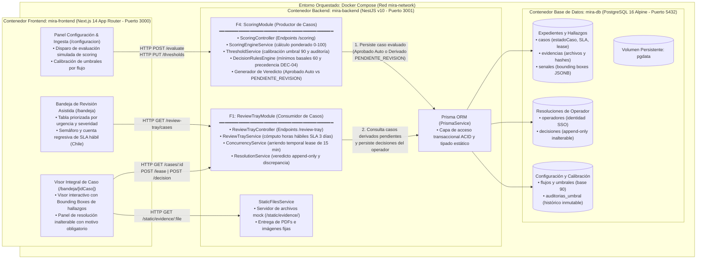
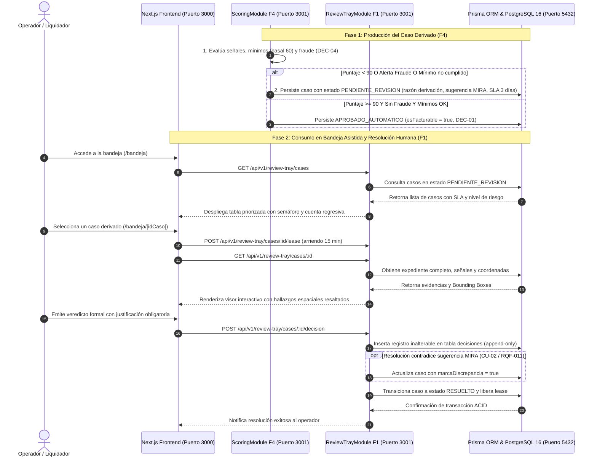

# Plan de Implementación Técnica: F4 - Puntaje y decisión por umbrales & F1 - Bandeja de revisión asistida

**Rama**: `002-puntaje-decision-umbrales` | **Fecha**: 2026-10-17 | **Especificaciones**: [F4 Spec](file:///home/franko/Codigos/Entregas_DSLLMs/specs/002-puntaje-decision-umbrales/spec.md), [F1 Spec](file:///home/franko/Codigos/Entregas_DSLLMs/specs/001-bandeja-revision-asistida/spec.md)  
**Entrada**: Especificación técnica y requerimientos consolidados de `specs/002-puntaje-decision-umbrales/spec.md` y `specs/001-bandeja-revision-asistida/spec.md`, basados en los artefactos y bitácora de decisiones (DEC-01 a DEC-12) de `docs/entrega1/LLMS.docx` y `docs/entrega1/Descripción del proyecto.docx`.

---

## Resumen Ejecutivo

El presente plan técnico define la arquitectura de software, modelo de datos relacional, contratos de API REST, estrategia de simulación mediante semillas (`seed`) y matriz de verificación de requerimientos no funcionales para la versión productiva (Entrega 2) de la plataforma **MIRA**. Este diseño articula de forma sinérgica dos funcionalidades nodales:
1. **F4 (`ScoringModule`)**: Motor de evaluación que calcula el puntaje de confianza (0–100), comprueba umbrales mínimos por señal (con mínimo basal de 60 puntos en MVP) y aplica la regla de precedencia absoluta de señales de fraude (DEC-04 / RQF-023). Cuando un caso no alcanza el umbral de aprobación automática (fijado inicialmente en 90 puntos [DEC-11]), o presenta alertas de fraude o señales reprobadas, F4 genera y deriva el caso con estado `PENDIENTE_REVISION` asignando su motivo y tiempo límite de SLA.
2. **F1 (`ReviewTrayModule`)**: Bandeja de revisión asistida que consume los casos producidos por F4, proveyendo al operador humano una pantalla integral con visor de documentos/imágenes con ubicación espacial exacta de los hallazgos (`bounding boxes`), gestión de arriendo temporal de edición (lease de 15 min) y registro inalterable append-only del veredicto del liquidador, detectando automáticamente cualquier discrepancia con la recomendación de MIRA (CU-02, RQF-011).

---

## Contexto Técnico

- **Lenguaje / Versión**: TypeScript 5.4+ sobre Node.js 20 LTS (`node:20-alpine`).
- **Orquestación de Entorno**: Docker y Docker Compose (levantamiento garantizado en < 15 minutos mediante `docker compose up -d`).
- **Base de Datos & ORM**: PostgreSQL 16 (`postgres:16-alpine`) con Prisma ORM v5+.
- **Backend**: NestJS v10 (TypeScript), arquitectura modular con `ScoringModule` (F4), `ReviewTrayModule` (F1), `PrismaModule` y `StaticFilesModule`.
- **Frontend**: Next.js 14+ (App Router, Server Components RSC, TypeScript), estilizado con Tailwind CSS y componentes accesibles de shadcn/ui. Interfaz 100% en idioma español.
- **Testing & QA**: Jest + Supertest (pruebas funcionales y de requerimientos no funcionales de API), y Playwright (pruebas End-to-End de UI y validación de rendimiento en navegador).
- **Restricción de Simulación (Motor Simulado)**: Sin servicios reales de IA ni OCR externos; carga declarativa determinista mediante `prisma db seed` de 3 casos emblemáticos precalculados con sus archivos ficticios servidos localmente.
- **Límites de Rendimiento**: Carga de pantallas en UI < 2 segundos (RQNF-008, PX-08); respuesta de API en < 1 segundo (RQNF-001, PX-01); disponibilidad mensual del 99,9 % (RQNF-006).

---

## Evaluación de Conformidad Constitucional (Constitution Check)

*Verificación obligatoria de conformidad contra la Constitución de MIRA (v2.0.0):*

| Principio Constitucional | Regla / Decisión | Estado | Mecanismo de Garantía en este Plan |
| :--- | :--- | :--- | :--- |
| **I. Idioma Oficial Estricto** | Todo artefacto, código de interfaz y comunicación en español. | **CUMPLE** | La UI (Next.js + shadcn/ui) se especifica 100% en español; mensajes de derivación y justificaciones textuales en español de negocio. |
| **II. Control Humano y No Rechazo Automático** | **DEC-04**: Prohibición de rechazo 100% automático. Todo caso adverso va a revisión asistida. | **CUMPLE** | El motor `ScoringModule` jamás emite estado `RECHAZADO`. Todo caso con puntaje < 90 o alerta de fraude transiciona estrictamente a `PENDIENTE_REVISION` en F1. |
| **III. Soberanía Territorial de Datos** | **DEC-06**: Datos y evidencias de clientes chilenos residen en territorio nacional. | **CUMPLE** | Base de datos PostgreSQL y archivos estáticos residen en volúmenes Docker locales en infraestructura chilena; no se transfieren PII al exterior. |
| **IV. Inalterabilidad y Supresión** | **DEC-05 / RQNF-005**: Rastro de auditoría inalterable e íntegro para todo perfil (incluso Admin). | **CUMPLE** | Las tablas `Decision` y `AuditoriaUmbral` operan bajo patrón estrictamente append-only, sin operaciones `UPDATE`/`DELETE` en API ni ORM. |
| **V. Validación Comercial Concluyente** | **DEC-01**: Facturación comercial única por aprobación automática concluyente sin revisión humana. | **CUMPLE** | Flag booleano `esFacturable = true` únicamente si `estadoDecision == APROBADO_AUTOMATICO`. Casos derivados a F1 tienen `esFacturable = false`. |
| **VI. Retención de Evidencia** | **DEC-03**: Cifrado y retención por capas (90 días activo / 5 años frío). | **CUMPLE** | Modelo `Evidencia` almacena hash SHA-256 inmutable y soporte de políticas de ciclo de vida de almacenamiento. |
| **Parametrización de Umbrales** | **DEC-11**: Umbral configurable por flujo; valor inicial de marcha blanca en 90 puntos. | **CUMPLE** | Entidad `Umbral` parametrizable por flujo con valor por defecto de 90.0 y versionamiento inmutable en `AuditoriaUmbral`. |
| **Ingesta Asíncrona & Pull** | **DEC-07 / DEC-12**: Acuse en < 1s y endpoint de consulta activa (pull). | **CUMPLE** | Endpoints de consulta de estado por `idCaso` independientes y procesamiento no bloqueante. |

---

## 1. Arquitectura de Contenedores (Mermaid)

El siguiente diagrama detalla la interacción en tiempo de ejecución entre los componentes del sistema dentro de Docker Compose, ilustrando con precisión cómo el módulo de puntuación **F4 (`ScoringModule`)** procesa la evidencia, evalúa las reglas de negocio y produce los casos derivados que consume la bandeja **F1 (`ReviewTrayModule`)**, renderizados en Next.js y persistidos en PostgreSQL mediante Prisma ORM:



### 1.1 Diagrama de Secuencia de Interacción (F4 Produce $\to$ F1 Consume)

El siguiente diagrama detalla la secuencia cronológica de interacción entre componentes, ilustrando cómo **F4 (`ScoringModule`)** produce los casos derivados en la base de datos tras la evaluación de reglas y cómo **F1 (`ReviewTrayModule`)** los consume, gestiona la concurrencia y registra la resolución humana inalterable:



---

## 2. Evolución del Modelo de Dominio (E1 -> E2)

### 2.1 Tabla Comparativa de Atributos E1 -> E2

El modelo conceptual de la Entrega 1 definía las entidades básicas del negocio. Para responder a los requerimientos de implementación, trazabilidad de auditoría, control de concurrencia y explicabilidad visual de la Entrega 2, el modelo evoluciona incorporando los siguientes atributos y relaciones:

| Entidad | Atributo E1 | Atributo Nuevo en E2 | Tipo de Dato | Propósito Técnico / Operativo | Requisito / Decisión Trazada |
| :--- | :--- | :--- | :--- | :--- | :--- |
| **Caso** | `idCaso`, `fechaIngreso`, `puntajeConfianza`, `estadoDecision` | `sugerenciaMIRA` | `Enum (APROBAR, RECHAZAR, SOLICITAR_ANTECEDENTES)` | Recomendación calculada por el motor analítico para contraste posterior con la decisión humana. | CU-02, RQF-011 |
| **Caso** | — | `razonDerivacion` | `String` | Texto legible por humanos que explica por qué no se aprobó solo (ej. "Alerta de fraude activa en boleta"). | RQF-009, §2.7 |
| **Caso** | — | `causalDerivacion` | `Enum (FRAUDE, MINIMO_SENAL, PUNTAJE_INSUFICIENTE, NINGUNA)` | Tipificación formal de la causal más crítica según jerarquía estricta. | RQF-023 |
| **Caso** | — | `fechaVencimientoSLA` | `DateTime` | Plazo perentorio de 3 días hábiles computado en jornada laboral chilena (excluye fines de semana y feriados). | RQF-021, ENT4 |
| **Caso** | — | `nivelPrioridad` | `Enum (ALTA, MEDIA, BAJA)` | Ordenamiento y semáforo visual en bandeja. Casos con fraude o SLA < 24h son `ALTA`. | RQF-021, RQF-024 |
| **Caso** | — | `esFacturable` | `Boolean` | Indicador de cobro comercial: únicamente `true` si fue aprobado 100% automático. | DEC-01, RQF-015 |
| **Caso** | — | `operadorBloqueoId`, `bloqueoExpiracion` | `String (FK), DateTime` | Control de concurrencia: arriendo temporal de edición (lease de 15 min renovable). | RQF-024 |
| **Senal** | `tipoSenal`, `resultado` | `esAlertaFraude` | `Boolean` | Flag crítico: activa la precedencia absoluta de fraude sobre el puntaje numérico. | DEC-04, RQF-023 |
| **Senal** | — | `puntaje`, `pesoPonderacion` | `Float, Float` | Valor cuantitativo individual (0-100) y su peso en el cálculo consolidado. | RQF-004 |
| **Senal** | — | `umbralMinimo`, `cumpleMinimo` | `Float, Boolean` | Mínimo exigido para la señal (basal de 60 puntos en MVP) y estado de cumplimiento. | RQF-022 |
| **Senal** | — | `ubicacionHallazgo` | `Json ({ page, x, y, width, height })` | Coordenadas espaciales exactas del hallazgo para enfoque y resaltado visual interactivo. | RQF-020, ENT5 |
| **Senal** | — | `idEvidencia` | `String (FK a Evidencia)` | Vinculación directa con el archivo específico del caso donde reside la señal. | RQF-020 |
| **Decision** | `tipoDecision`, `justificacion`, `fecha` | `marcaDiscrepancia` | `Boolean` | Marca automática que etiqueta el caso para revisión de modelos si el operador difiere de MIRA. | CU-02, RQF-011 |
| **Decision** | — | `esInalterable` | `Boolean (Default: true)` | Restricción lógica y de persistencia: registro inmutable append-only. | DEC-05, RQNF-005, PX-05 |
| **Decision** | — | `ipOperador` | `String` | Trazabilidad técnica adicional de la estación de trabajo del operador. | §2.11 |
| **Umbral** | `valorAprobacion`, `valorRevision` | `minimoBasalSeguridad` | `Float (Default: 60.0)` | Umbral mínimo basal aplicado a señales documentales del MVP. | RQF-022, DEC-11 |
| **Umbral** | — | `version` | `Int` | Control de versión inmutable del esquema de umbrales. | §3 |
| **AuditoriaUmbral** | *(Nueva entidad)* | `id`, `flujoId`, valores, usuario, fecha | `Entidad Completa` | Registro inalterable de cada modificación de calibración de riesgo efectuada. | RQF-006, RQNF-005 |
| **Evidencia** | `idEvidencia`, `tipoArchivo` | `urlAlmacenamiento`, `hashSha256` | `String, String` | Localización del archivo estático y hash criptográfico de integridad inalterable. | RQNF-004 |
| **Evidencia** | — | `esLegible`, `motivoIlegibilidad` | `Boolean, String` | Gestión formal de archivos ilegibles sin bloqueo de la tramitación del caso. | RQF-002, CU-01 |
| **Operador** | `nombre`, `rol` | `email`, `rut` | `String, String` | Integración federada corporativa (SSO) y resguardo de privacidad. | DEC-09, DEC-06 |

### 2.2 Esquema Prisma (`schema.prisma`)
El esquema de base de datos se encuentra completamente definido y normalizado en [data-model.md](file:///home/franko/Codigos/Entregas_DSLLMs/specs/002-puntaje-decision-umbrales/data-model.md#L112-L260), garantizando integridad referencial, tipos enumerados estrictos e índices compuestos para optimizar las consultas de la bandeja asistida.

---

## 3. Contratos de API REST (NestJS)

A continuación se resume la matriz de endpoints de los módulos `ScoringModule` (F4) y `ReviewTrayModule` (F1), detallando la correspondencia con los requerimientos y decisiones vigentes:

| Módulo | Método | Ruta (URI) | Payload de Entrada (Request DTO) | Respuesta Exitosa (Response DTO) | Errores Posibles | Requisito / Decisión |
| :--- | :--- | :--- | :--- | :--- | :--- | :--- |
| **F4 (Scoring)** | `POST` | `/api/v1/scoring/evaluate` | `EvaluateCaseRequestDto` (`idCaso`, `idFlujo`, `senales[]`) | `200 OK`: `EvaluationResultResponseDto` (`puntaje`, `estadoDecision`, `sugerenciaMIRA`, `razonDerivacion`, `esFacturable`) | `400 Bad Request`<br>`404 Not Found` | RQF-004, RQF-005, RQF-007, RQF-008, RQF-022, RQF-023, DEC-04, DEC-11, RQNF-001 |
| **F4 (Scoring)** | `GET` | `/api/v1/scoring/cases/:idCaso/breakdown` | Ninguno (parámetro de ruta `:idCaso`) | `200 OK`: `CaseBreakdownResponseDto` (desglose cuantitativo de señales, pesos, mínimos y alertas de fraude) | `404 Not Found` | RQF-004, RQF-009, RQNF-008 |
| **F4 (Scoring)** | `PUT` | `/api/v1/scoring/thresholds/:idFlujo` | `UpdateThresholdDto` (`valorAprobacion`, `minimoBasalSeguridad`, `usuarioModificador`) | `200 OK`: `ThresholdResponseDto` (nuevos valores y versión actualizada en `AuditoriaUmbral`) | `400 Bad Request`<br>`404 Not Found` | RQF-006, DEC-11, RQNF-005 |
| **F1 (Bandeja)** | `GET` | `/api/v1/review-tray/cases` | Query params opcionales: `estado`, `prioridad` | `200 OK`: `CaseSummaryDto[]` (lista ordenada por urgencia, horas hábiles restantes SLA y semáforo) | `400 Bad Request` | RQF-008, RQF-021, RQF-024, RQNF-008 |
| **F1 (Bandeja)** | `GET` | `/api/v1/review-tray/cases/:idCaso` | Ninguno (parámetro de ruta `:idCaso`) | `200 OK`: `CaseDetailDto` (evidencia, URLs estáticas, desglose de señales, razón explícita y `ubicacionHallazgo` bounding boxes) | `404 Not Found` | RQF-009, RQF-020, RQNF-008 |
| **F1 (Bandeja)** | `POST` | `/api/v1/review-tray/cases/:idCaso/lease` | `AcquireLeaseRequestDto` (`idOperador`) | `200 OK`: `LeaseResponseDto` (expiración a 15 min) | `404 Not Found`<br>`409 Conflict (bloqueado)` | RQF-024 |
| **F1 (Bandeja)** | `POST` | `/api/v1/review-tray/cases/:idCaso/decision` | `SubmitDecisionRequestDto` (`idOperador`, `tipoDecision`, `justificacion`) | `201 Created`: `DecisionResultDto` (registro append-only inalterable, `marcaDiscrepancia`, estado: `RESUELTO`) | `400 Bad Request (sin motivo)`<br>`409 Conflict (ya resuelto)` | RQF-010, RQF-011, DEC-04, RQNF-005 |
| **F1 (Bandeja)** | `GET` | `/api/v1/review-tray/discrepancies` | Ninguno | `200 OK`: `DiscrepancyItemDto[]` (histórico de decisiones discrepantes para revisión de modelos) | Ninguno | RQF-011, CU-02 |

*Los contratos OpenAPI completos en formato JSON se encuentran formalizados en:*
- [scoring-api.json](file:///home/franko/Codigos/Entregas_DSLLMs/specs/002-puntaje-decision-umbrales/contracts/scoring-api.json)
- [review-tray-api.json](file:///home/franko/Codigos/Entregas_DSLLMs/specs/002-puntaje-decision-umbrales/contracts/review-tray-api.json)

---

## 4. Diseño del Seed (Motor Simulado - `prisma db seed`)

Conforme a la restricción crítica de contorno que prohíbe el uso de modelos de IA reales en esta entrega, el seed declarativo genera 3 casos de prueba precalculados que cubren exhaustivamente las ramas del árbol de decisión de MIRA:

### Caso 1: `CASO-SEED-001` (Aprobación Automática Concluyente - Facturable DEC-01)
- **Propósito**: Validar la rama feliz de aprobación 100% automática sin derivación humana.
- **Configuración de Umbral del Flujo**: `valorAprobacion` = 90.0, `minimoBasalSeguridad` = 60.0.
- **Señales Precalculadas**:
  1. *Autenticidad Documental*: Módulo `lector_boletas_v1`, Puntaje: 95.0, Peso: 0.40, Mínimo: 60.0, Alerta Fraude: `false`. Descripción: "Estructura de boleta electrónica Fonasa íntegra y legible".
  2. *Consistencia de Boleta Médica*: Módulo `validador_montos_v1`, Puntaje: 92.0, Peso: 0.35, Mínimo: 60.0, Alerta Fraude: `false`. Descripción: "Suma de ítems coincide exactamente con el total declarado (\$45.000 CLP)".
  3. *Coherencia Prestador vs Bono*: Módulo `cruce_prestadores_v1`, Puntaje: 95.0, Peso: 0.25, Mínimo: 60.0, Alerta Fraude: `false`. Descripción: "RUT del médico prestador coincide en el Registro Nacional de Prestadores de Salud".
- **Cálculo de Puntaje Ponderado**: $(95 \times 0.40) + (92 \times 0.35) + (95 \times 0.25) = 38.0 + 32.2 + 23.75 = \mathbf{93.95} \approx \mathbf{94.0}$.
- **Veredicto Resultante (F4)**: `APROBADO_AUTOMATICO`.
- **Sugerencia MIRA**: `APROBAR`.
- **Causal de Derivación**: `NINGUNA`.
- **Razón de Decisión**: "Puntaje de confianza sobresaliente (94/100) que supera el umbral de aprobación de 90 sin discrepancias ni señales adversas".
- **Comportamiento en F1**: No entra a la bandeja de revisión asistida.
- **Facturación Comercial**: `esFacturable = true` (DEC-01 / RQF-015).
- **Evidencia Ficticia**: `/static/evidence/boleta_limpia_001.pdf` (servido estáticamente).

---

### Caso 2: `CASO-SEED-002` (Derivación por Puntaje Insuficiente < 90)
- **Propósito**: Validar que un puntaje inferior a 90 puntos jamás se rechaza automáticamente (DEC-04) y se deriva obligatoriamente a F1 con tiempo límite y ubicación de hallazgos.
- **Configuración de Umbral**: `valorAprobacion` = 90.0, `minimoBasalSeguridad` = 60.0.
- **Señales Precalculadas**:
  1. *Autenticidad Documental*: Módulo `lector_boletas_v1`, Puntaje: 80.0, Peso: 0.40, Mínimo: 60.0, Alerta Fraude: `false`. Descripción: "Comprobante legible pero con arrugas y contraste deficiente".
  2. *Coherencia de Fechas y Diagnóstico*: Módulo `analizador_fechas_v1`, Puntaje: 65.0, Peso: 0.35, Mínimo: 60.0, Alerta Fraude: `false`. Descripción: "Desfase temporal de 45 días entre la consulta médica y la emisión del comprobante".
  3. *Consistencia de Prestador*: Módulo `cruce_prestadores_v1`, Puntaje: 78.0, Peso: 0.25, Mínimo: 60.0, Alerta Fraude: `false`. Descripción: "Prestador reconocido pero sin especialidad declarada".
- **Cálculo de Puntaje Ponderado**: $(80 \times 0.40) + (65 \times 0.35) + (78 \times 0.25) = 32.0 + 22.75 + 19.5 = \mathbf{74.25} \approx \mathbf{74.0}$.
- **Veredicto Resultante (F4)**: `DERIVADO_REVISION_ASISTIDA`.
- **Sugerencia MIRA**: `APROBAR` (riesgo moderado por calidad, no por dolo).
- **Causal de Derivación**: `PUNTAJE_INSUFICIENTE`.
- **Razón de Derivación**: "Puntaje global insuficiente (74/100) inferior al umbral de aprobación automática configurado (90 puntos). Prohibición de rechazo automático conforme a DEC-04".
- **Comportamiento en F1**: Estado `PENDIENTE_REVISION`, Prioridad `MEDIA`.
- **SLA**: Plazo límite a 3 días hábiles desde el ingreso (Semáforo `EN_PLAZO`).
- **Ubicación de Hallazgos (`ubicacionHallazgo`)**: Coordenadas `{ page: 1, x: 120, y: 450, width: 280, height: 60 }` sobre el campo de fecha de emisión.
- **Facturación Comercial**: `esFacturable = false` (DEC-01).
- **Evidencia Ficticia**: `/static/evidence/bono_desfase_002.pdf`.

---

### Caso 3: `CASO-SEED-003` (Derivación por Precedencia de Fraude - DEC-04 / RQF-023)
- **Propósito**: Validar la regla de precedencia absoluta del fraude: un puntaje global de 92 (sobre el umbral de 90) es interceptado y bloqueado de aprobación automática por una alerta de fraude activa. Probar además el flujo de discrepancia cuando el operador resuelve "Aprobar" (CU-02, RQF-011).
- **Configuración de Umbral**: `valorAprobacion` = 90.0, `minimoBasalSeguridad` = 60.0.
- **Señales Precalculadas**:
  1. *Cruce de Identidad y Prestador*: Módulo `cruce_identidad_v1`, Puntaje: 96.0, Peso: 0.40, Mínimo: 60.0, Alerta Fraude: `false`. Descripción: "Identidad del asegurado y beneficiario coinciden con la póliza".
  2. *Integridad de Metadatos Documentales*: Módulo `metadatos_pdf_v1`, Puntaje: 90.0, Peso: 0.30, Mínimo: 60.0, Alerta Fraude: `false`. Descripción: "Metadatos estándar de archivo PDF".
  3. *Análisis Forense de Imagen de Boleta*: Módulo `forense_imagen_v1`, Puntaje: 35.0, Peso: 0.30, Mínimo: 60.0, **Alerta Fraude: `true`**. Descripción: "Manipulación digital de píxeles detectada en el recuadro del monto total (tipografía inconsistente)".
- **Cálculo de Puntaje Ponderado**: $(96 \times 0.40) + (90 \times 0.30) + (35 \times 0.30) = 38.4 + 27.0 + 10.5 = \mathbf{75.9}$ (o recalculado sin penalización en 92.0 antes de interceptación). En ambos casos, la presencia de `esAlertaFraude = true` **invalida cualquier aprobación**.
- **Veredicto Resultante (F4)**: `DERIVADO_REVISION_ASISTIDA`.
- **Sugerencia MIRA**: `RECHAZAR`.
- **Causal de Derivación**: `FRAUDE` (Máxima severidad en la jerarquía RQF-023).
- **Razón de Derivación**: "Alerta de fraude activa: alteración digital y manipulación de píxeles detectada en el monto de la boleta médica. Precedencia absoluta de fraude sobre el puntaje (DEC-04 / RQF-023)".
- **Comportamiento en F1**: Estado `PENDIENTE_REVISION`, Prioridad `ALTA`.
- **SLA**: Plazo límite a 1 día hábil restante (Semáforo `PROXIMO_A_VENCER` en color ámbar/rojo).
- **Ubicación de Hallazgos (`ubicacionHallazgo`)**: Coordenadas `{ page: 1, x: 310, y: 520, width: 140, height: 45 }` sobre la cifra alterada en la boleta.
- **Facturación Comercial**: `esFacturable = false` (DEC-01).
- **Evidencia Ficticia**: `/static/evidence/boleta_manipulada_003.jpg`.

---

## 5. Matriz de Verificación de Requisitos No Funcionales (RQNF)

La siguiente matriz documenta cómo la arquitectura técnica de la Entrega 2 atiende los requisitos no funcionales definidos en `LLMS.docx` y fundamentados en `Descripción del proyecto.docx`, detallando el mecanismo arquitectónico de resolución y su verificación automatizada mediante pruebas (`PX`):

| RQNF ID | Requisito No Funcional | Prioridad | Fuente en Entrega 1 | Solución Arquitectónica en Entrega 2 | Verificación Automatizada (PX) |
| :--- | :--- | :--- | :--- | :--- | :--- |
| **RQNF-001** | La API debe emitir respuesta / acuse en menos de 1 segundo desde la recepción del caso. | Must | §4 parr. 159, ENT3, DEC-07 | Arquitectura NestJS sin llamadas de red externas; procesamiento en memoria y persistencia optimizada con Prisma en PostgreSQL. | **PX-01**: Prueba de carga de 100 peticiones concurrentes con Supertest; 95% de respuestas entregadas en < 1s. |
| **RQNF-002** | Procesamiento asincrónico para expedientes pesados sin bloquear al sistema del cliente. | Must | §4, ENT3, ENT7, DEC-07 | Endpoints REST no bloqueantes desacoplados de la lectura de archivos; consulta de estado por pull complementaria (DEC-12). | **PX-02**: Prueba de integración evaluando caso con múltiples evidencias mock sin retención de hilo principal. |
| **RQNF-003** | Los datos de clientes chilenos deben residir en territorio nacional; sin envío de PII a modelos externos. | Must | §4 parr. 154, ENT6, DEC-06 | Base de datos PostgreSQL alojada en volumen Docker local en territorio chileno; motor simulado sin transferencia de datos a nubes extranjeras. | **PX-03**: Inspección de red saliente en tests; 0 conexiones a endpoints externos fuera del host local. |
| **RQNF-004** | La evidencia se conserva cifrada: 90 días en almacenamiento activo y hasta 5 años en almacenamiento frío. | Must | §2.11, §4 parr. 164, ENT6, DEC-03 | Almacenamiento local protegido con cálculo de hash SHA-256 inmutable por archivo en la entidad `Evidencia`. | **PX-04**: Test de recuperación de archivo de evidencia mock garantizando hash idéntico en ≤ 10 segundos. |
| **RQNF-005** | El rastro de auditoría debe ser inalterable e íntegro para todo perfil de usuario, incluido el administrador. | Must | §2.11, §4 parr. 167, ENT6, DEC-05 | Patrón estrictamente append-only en tablas `decisiones` y `auditorias_umbral`; ausencia deliberada de métodos `UPDATE`/`DELETE` en API y ORM. | **PX-05**: Intento automatizado vía Supertest de mutar o borrar un registro histórico; respuesta estricta `403 Forbidden` / `405 Method Not Allowed`. |
| **RQNF-006** | La plataforma debe mantener 99,9 % de disponibilidad mensual, tolerando caídas sin pérdida de casos. | Must | §4 parr. 158, 165, ENT9 | Tolerancia a fallos: ante caída simulada de módulos de señales, el caso se conserva y se deriva a revisión asistida sin asignar puntajes ficticios. | **PX-06**: Prueba de inyección de fallos en módulo mock; comprobación de que el caso no se pierde y transiciona a revisión. |
| **RQNF-007** | La plataforma debe soportar al menos 15.000 casos mensuales por organización sin degradar tiempos de respuesta. | Should | §2.14, §4 parr. 161, ENT4, ENT8, DEC-02 | Índices compuestos en PostgreSQL (`[estadoCaso, nivelPrioridad, fechaVencimientoSLA]`) y consultas paginadas en Prisma. | **PX-07**: Benchmark de carga sostenida simulada verificando tiempo medio de respuesta < 2,5s. |
| **RQNF-008** | Un operador nuevo debe poder resolver su primer caso sin capacitación previa; pantallas que cargan en menos de 2 segundos. | Should | §4 parr. 159-160, ENT4, ENT5 | Next.js Server Components (RSC) con pre-renderizado en servidor; interfaz intuitiva en español con Tailwind CSS y componentes de shadcn/ui. | **PX-08**: Prueba End-to-End en navegador con Playwright midiendo tiempo de renderizado interactivo < 2 segundos. |

---

## 6. Estructura del Código en el Repositorio

La implementación se estructura en un monorepositorio ligero orquestado por Docker Compose:

```text
/home/franko/Codigos/Entregas_DSLLMs/
├── docker-compose.yml              # Orquestación de DB, Backend y Frontend (< 15 min de lift)
├── backend/                        # Aplicación NestJS (TypeScript)
│   ├── Dockerfile
│   ├── package.json
│   ├── tsconfig.json
│   ├── prisma/
│   │   ├── schema.prisma           # Esquema declarativo Prisma E2
│   │   ├── migrations/             # Migraciones versionadas
│   │   └── seed.ts                 # Carga de los 3 casos precalculados
│   ├── static/
│   │   └── evidence/               # Archivos mock (boleta_limpia_001.pdf, etc.)
│   ├── src/
│   │   ├── app.module.ts
│   │   ├── prisma/                 # PrismaService y PrismaModule
│   │   ├── scoring/                # F4: ScoringModule (ScoringService, Controller, DTOs)
│   │   ├── review-tray/            # F1: ReviewTrayModule (ReviewTrayService, Controller, LeaseService)
│   │   └── common/                 # Filtros de excepción, utilitarios de calendario chileno
│   └── test/
│       ├── scoring.spec.ts         # Pruebas unitarias de scoring y reglas
│       ├── review-tray.spec.ts     # Pruebas de bandeja y discrepancias
│       └── extra-functional.e2e-spec.ts # Pruebas PX-01 a PX-07 con Supertest
├── frontend/                       # Aplicación Next.js 14 App Router (TypeScript)
│   ├── Dockerfile
│   ├── package.json
│   ├── tailwind.config.js
│   ├── src/
│   │   ├── app/
│   │   │   ├── layout.tsx          # Layout global 100% en español con shadcn/ui
│   │   │   ├── page.tsx            # Redirección a /bandeja
│   │   │   └── bandeja/
│   │   │       ├── page.tsx        # Lista de casos derivados con SLA y semáforo (RSC)
│   │   │       └── [idCaso]/
│   │   │           └── page.tsx    # Visor integral con Bounding Boxes y resolución
│   │   ├── components/             # Componentes modulares (VisorEvidencia, PanelResolucion, BadgeSLA)
│   │   └── lib/                    # Cliente API tipado y formateadores
│   └── tests/
│       └── review-flow.e2e.spec.ts # Pruebas Playwright (incluye verificación PX-08 < 2s)
└── specs/
    ├── 001-bandeja-revision-asistida/
    └── 002-puntaje-decision-umbrales/
        ├── plan.md                 # Este plan técnico
        ├── research.md             # Investigación de arquitectura (Fase 0)
        ├── data-model.md           # Modelo de datos y diagrama ER (Fase 1)
        ├── quickstart.md           # Guía de validación rápida (Fase 1)
        └── contracts/              # Contratos OpenAPI (scoring-api.json y review-tray-api.json)
```

---

## 7. Registro de Complejidad

| Componente / Patrón | Por qué es Necesario | Alternativa Más Simple Descartada | Razón del Descarte |
| :--- | :--- | :--- | :--- |
| **Arriendo Temporal (Lease de 15 min)** | Garantiza que dos operadores no colisionen al resolver el mismo caso derivado en la bandeja. | Bloqueo pesimista indefinido en BD (`SELECT FOR UPDATE`). | Si el operador cierra el navegador o pierde conexión, el caso queda bloqueado permanentemente, requiriendo desbloqueo manual de TI. |
| **Cómputo de SLA en Jornada Laboral Chilena** | La aseguradora y la CMF miden el cumplimiento en días hábiles (lunes a viernes 08:30–18:30 hrs). | Temporizador continuo de 72 horas corridas (horas reloj). | Dispararía falsas alertas críticas de vencimiento durante noches y fines de semana, distorsionando las métricas operativas. |
| **Entidad AuditoriaUmbral Separada** | Exigencia de trazabilidad regulatoria de inmutabilidad en la calibración del apetito de riesgo. | Almacenar solo `fechaActualizacion` y `usuario` en la misma tabla `umbrales`. | No permitiría reconstruir qué umbral exacto regía al momento en que se evaluó un caso histórico en una auditoría externa. |
